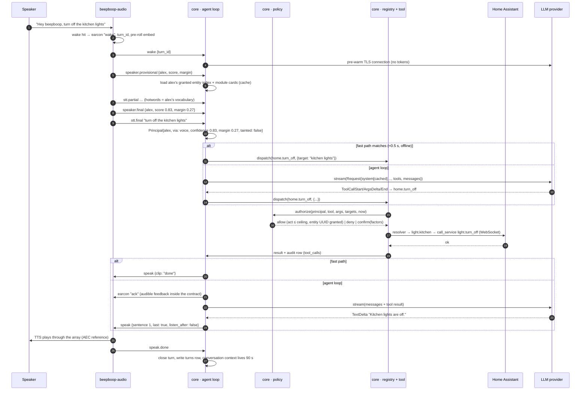

# Architecture

> Status: Draft spec · 2026-11-01 · Applies to: M0, v0.1 (notes where v0.2+ differs)

beepboop is a Raspberry Pi 4 voice assistant that wakes on "Hey beepboop", identifies who is speaking, and acts on that person's profile through Home Assistant and per-person integrations. It runs as four containers: a reverse proxy, a core service (agent loop, policy, tool registry, MCP server, web API, database), an audio service (everything that touches PCM), and Home Assistant. Audio never leaves the audio service; only text events cross to the core over a unix socket. One tool registry serves both the in-process voice agent and external MCP clients, and every call, whichever door it came through, passes the same deterministic policy check.

Related: [README](../README.md) · [Glossary](GLOSSARY.md) · [Voice pipeline](VOICE_PIPELINE.md) · [Identity and trust](IDENTITY_AND_TRUST.md) · [Modules](MODULES.md) · [MCP](MCP.md) · [Home Assistant](HOME_ASSISTANT.md) · [LLM providers](LLM_PROVIDERS.md) · [Web UI](WEB_UI.md) · [Data and privacy](DATA_AND_PRIVACY.md) · [Operations](OPERATIONS.md) · [Roadmap](ROADMAP.md) · [ADRs](adr/README.md)

---

## 1. System context

```
                 LAN (household)                                  Internet (opt-in, text only)
 ┌──────────────────────────────────────────────┐        ┌──────────────────────────────────┐
 │  People speak to the ReSpeaker array         │        │  Amazon Bedrock (Claude Haiku 5.5)│
 │  Phones/laptops open https://beepboop.local  │        │  or any OpenAI-compatible endpoint│
 │  (web UI, approvals, enrollment, activity)   │        │  Optional: Deepgram / Polly       │
 │  Zigbee/Z-Wave/Wi-Fi devices ⇄ Home Assistant│        │  CalDAV / weather HTTP APIs       │
 │  v0.2: Claude Desktop / Code as MCP clients  │        │  (per module, via core only)      │
 └──────────────┬───────────────────────────────┘        └──────────────────┬───────────────┘
                │ mic + speaker (USB)   HTTPS :443                            │ HTTPS egress
         ┌──────▼─────────────────────────────────────────────────────────────▼───────┐
         │                              Raspberry Pi 4                                 │
         │  caddy ── beepboop-core ──unix socket (JSON lines)── beepboop-audio          │
         │             │ one WebSocket (loopback)                                      │
         │          homeassistant                                                      │
         └─────────────────────────────────────────────────────────────────────────────┘
```

Three facts shape everything else:

1. **The Pi is the whole product.** There is no cloud account, relay or hosted service. The only hosted thing the project ever runs is a static OAuth bounce page in v0.2 that holds no secrets.
2. **Latency is a contract, not a goal.** The latency contract ([ADR 0015](adr/0015-latency-contract-and-fast-path.md)) sets the numbers; a deterministic fast path keeps the common commands working offline. M0 proves the contract on a real Pi before v0.1 starts.
3. **Voice ID is personalization, not authentication** ([ADR 0006](adr/0006-voice-id-is-personalization.md)). It picks the profile; risk tiers, grants and a second factor decide what that profile may do.

---

## 2. Containers

Four containers; three are ours. All images are pinned by digest. The canonical deploy shape is [OPERATIONS §3](OPERATIONS.md#3-compose-layout); memory limits and the resource budget are in [OPERATIONS §7](OPERATIONS.md#7-resource-budget) and are **targets to be validated in M0**.

| Container | Image | Owns | Network |
|---|---|---|---|
| `caddy` | `ghcr.io/jaminb/beepboop-caddy` | TLS (local CA at Tier 0, ACME DNS-01 at Tier 1), `:443 → 127.0.0.1:8080`, the single route `/auth/external/callback → HA`, admin-gated `:8443` (HA UI) and `:8445` (Music Assistant UI) | `network_mode: host`; publishes `:443` (and `:80` redirect) |
| `beepboop-core` | `ghcr.io/jaminb/beepboop-core` (Python 3.12, FastAPI) | agent loop, fast path, policy, tool registry, modules, MCP server (`/mcp`), web API + static SPA, SQLite, nightly jobs, HA WebSocket client | `network_mode: host`; binds `127.0.0.1:8080`; reaches HA at `127.0.0.1:8123`; egress to LLM/cloud |
| `beepboop-audio` | `ghcr.io/jaminb/beepboop-audio` (Python 3.12, sherpa-onnx, pymicro-wakeword) | ALSA capture/playback (`/dev/snd`), wake word, VAD, speaker ID, STT, TTS, earcons, spoken-PIN capture, enrollment capture | `network_mode: none`; the `deploy/compose.cloud-speech.yaml` override gives it egress for the v0.2 cloud speech plugins |
| `homeassistant` | `ghcr.io/home-assistant/home-assistant@sha256:…` | devices, integrations, state, automations, Music Assistant bridge | `network_mode: host` (discovery); HTTP bound to `127.0.0.1:8123`; nftables drops LAN traffic to `:8123` |

Data root on the host: `/srv/beepboop/{core,audio,ha,models,config,backups}`. Shared mounts: `/run/beepboop` (the unix socket `audio.sock`), `/srv/beepboop/core → /data` in core (SQLite `beepboop.db`, keys), `/srv/beepboop/audio → /data` in audio (TTS cache, calibration), `/srv/beepboop/models → /models` (speech models + `LICENSES.md`, read-only), and the one household config file `/srv/beepboop/config/beepboop.yaml` mounted read-only at `/config/beepboop.yaml` into both core and audio (§9).

### 2.1 Optional compose profiles

The only optional beepboop compose profile in v0.1 is **`music`** (Music Assistant server, [HOME_ASSISTANT §12](HOME_ASSISTANT.md#12-music-assistant-path-music-module-v01)), off by default. Cloud speech (v0.2) is the `deploy/compose.cloud-speech.yaml` override, not a profile; Wyoming adapters are v0.2 ([ROADMAP](ROADMAP.md)). HA add-on containers are not beepboop's concern ([HOME_ASSISTANT §1](HOME_ASSISTANT.md#1-why-home-assistant)). Resource limits, zram and update-with-rollback: [OPERATIONS.md](OPERATIONS.md), [ADR 0016](adr/0016-docker-compose-mit.md).

---

## 3. Responsibilities and boundaries

```
┌─ beepboop-audio ────────────────────────────┐   ┌─ beepboop-core ──────────────────────────────────┐
│ PCM in (ALSA, XVF3800 ASR beam, 16 kHz)      │   │ Turn state machine, Principal construction        │
│ Ring buffer (pre-roll ≈1 s)                  │   │ Fast path (deterministic intents)                 │
│ WakeProvider → wake hit                      │   │ Agent loop (LLMProvider, sentence chunking)       │
│ Silero VAD, endpointing                      │   │ Policy middleware (tiers, grants, taint, ceiling) │
│ SpeakerProvider + identify (centroids pushed │   │ Tool registry (core tools + module tools)         │
│   from core), provisional + final            │   │ Modules (native | ha | mcp_proxy)                 │
│ SttProvider (streaming, hotwords)            │   │ HA WebSocket client (policy-wrapped)              │
│ TtsProvider → playback queue, earcons        │   │ MCP server at /mcp (external front door)          │
│ Spoken-PIN capture + verify against hash     │   │ Web API (/api), static SPA, sessions, TOTP        │
│ Enrollment clip capture, quality gates       │   │ SQLite (single writer), secrets, retention        │
│ Mic mute state, LEDs                         │   │ Nightly jobs, backups                             │
│ NO: policy, LLM, HA, DB, network (default)   │   │ NO: PCM, model inference, ALSA                    │
└──────────────────────────────────────────────┘   └───────────────────────────────────────────────────┘
```

Boundary rules, each with its ADR:

- **Audio never crosses a process boundary** ([ADR 0008](adr/0008-audio-core-process-split.md)). The socket carries JSON text. Embeddings (`hello.speaker.dim` floats, 512 in v0.1) are numbers, not audio, and may cross in both directions. The spoken PIN never crosses at all: core sends the argon2id hash in `capture_pin`, audio verifies and answers `pin.result{outcome}`.
- **Policy lives in core, once** ([ADR 0005](adr/0005-risk-tiers-and-grants.md)). The audio service does not know about tiers or grants. Modules do not either; they receive an already-authorized call.
- **Modules never import MCP, HA or LLM SDKs** ([ADR 0007](adr/0007-module-contract.md)). They get a `ToolContext`. The `ha` client inside it is policy-wrapped; the HA admin token is never visible to a module.
- **HA is the integration backbone, HA's MCP server is not used** ([ADR 0001](adr/0001-home-assistant-backbone.md)). beepboop is the only enforcement point, so HA must be unreachable from the LAN.
- **Wyoming stays at the edges.** A Wyoming client adapter can back `SttProvider`/`TtsProvider` (v0.2); a Wyoming satellite server (v0.3) feeds remote mics into the audio service. Wyoming is never the internal bus; it has no auth and would add a hop per audio chunk.

---

## 4. Audio ⇄ core event protocol

This section is the only normative definition of the transport, the envelope and the event catalog. [VOICE_PIPELINE §5](VOICE_PIPELINE.md#5-events-between-audio-and-core) says only *when* each audio-side event fires. The protocol is implemented once, as pydantic models in `protocol/beepboop_protocol/` (workspace package `beepboop-protocol`), which both services depend on; it imports nothing audio-capable ([ADR 0019](adr/0019-shared-protocol-package-and-negotiated-embedding-dim.md)). The current protocol major is **2**. Protocol 1 (fixed 192-float embeddings) was never released.

### 4.1 Transport and framing

- **Socket:** `unix:///run/beepboop/audio.sock` (env var `BB_AUDIO_SOCKET` in both containers). The audio service **listens** (it owns the device; satellites later follow the same shape). Core **connects** and reconnects with backoff 0.5 s → 5 s.
- **Framing:** JSON lines. One UTF-8 JSON object per `\n`-terminated line. No binary payloads. The `{type, data}` shape mirrors Wyoming headers so edge adapters are trivial.
- **Envelope:**

```json
{"type": "stt.final", "seq": 418, "ts": 1793657612.482, "turn_id": "01JBX6Q8Y4H3K9ZR2M7V5T8WDA", "data": {...}}
```

| Field | Type | Notes |
|---|---|---|
| `type` | string | Event name from the catalog below |
| `seq` | int | Per-sender monotonic counter; gaps are logged, never fatal |
| `ts` | float | Unix seconds with ms precision (both containers share the host clock). Core records receive time too; the difference is the socket hop in the latency waterfall |
| `turn_id` | string (ULID) or absent | Assigned by audio at `wake`. **Required** on the eight canonical events (which include `capture_pin`) and on `pin.result`. **Optional** on `speak.done`, `earcon` and `error`, which carry it when they belong to a turn. **Forbidden** on every other event (`hello`, `health`, `mic.state`, `mute`, `profiles.sync`, `enroll.*`) |
| `data` | object | Event-specific fields |

Unknown `type` values are ignored and logged at debug level; unknown `data` fields are ignored. Both sides send `hello` first and refuse to proceed on a protocol-major mismatch.

### 4.2 Event catalog

Events marked **canonical** are the eight turn events; they are the only events that carry turn content (transcripts, identity, speech). The rest are control plane (handshake, health, voiceprint sync, enrollment, playback, mute, PIN outcomes) and carry no transcript text. Field types: `str`, `int`, `float`, `bool`, `?` = optional. `t_*` fields are audio-side `time.monotonic_ns()` capture stamps ([VOICE_PIPELINE §3](VOICE_PIPELINE.md#3-frames-clocks-and-the-ring-buffer)); core uses them to build the latency waterfall. `turn_id` is never a `data` field; it travels in the envelope under the §4.1 rule.

**Identity in events.** `profile_id` is always present on `speaker.*` events. Guest is encoded as `profile_id: "guest"`, the fixed id of the built-in guest profile, never as an absent field and never as `"GUEST"`. Every other `profile_id` is the profile's ULID (`profiles.id`).

**Audio → core**

| Event | Fields | When |
|---|---|---|
| `hello` | `protocol: 2`, `role: "audio"`, `device: {id, name}`, `wake: {provider, models[]}`, `stt: {provider, locale}`, `tts: {provider, voices[]}`, `speaker: {model_id, model_sha, dim: int}`, `aec_verified: bool` | On connect. `speaker.dim` fixes the length of every embedding on this connection (§4.4); 512 for the v0.1 CAM++ model ([VOICE_PIPELINE §8.1](VOICE_PIPELINE.md#81-model)) |
| **`wake`** (canonical) | `device: str`, `model: str` ("hey_beepboop"), `score: float`, `trigger: "wake"\|"reply"\|"button"`, `preroll_ms: int`, `t_wake: int` | Wake hit, a reply window opened after a `speak` with `listen_after: true` (§5 step 10), or the array button. Opens the turn; audio plays the `wake` earcon itself |
| **`speaker.provisional`** (canonical) | `profile_id: str` ("guest" when unrecognized), `score: float`, `margin: float`, `stage: "provisional"`, `audio_ms: int` | ~100 ms after wake, from the text-dependent pre-roll |
| **`speaker.final`** (canonical) | `profile_id: str`, `score`, `margin`, `stage: "final"`, `anchor: bool` (false when no wake phrase was in the audio, i.e. a reply-window turn), `audio_ms`, `candidates: [{profile_id, score}]` (top 3) | At ≤2 s of command audio or end-of-speech, whichever is first. Always precedes `stt.final` |
| **`stt.partial`** (canonical) | `text: str`, `stable: bool` | Streaming hypothesis, at most one per 200 ms; `stable` prefixes will not change |
| **`stt.final`** (canonical) | `text: str`, `locale: str`, `speech_ms: int`, `endpoint: "silence"\|"max_len"\|"cancel"`, `empty: bool`, `provider: str`, `t_speech_start: int`, `t_eos: int`, `t_final: int` | End-of-speech. `empty: true` means no speech after the wake word (false wake); core ends the turn silently |
| `pin.result` | `approval_id: str`, `outcome: "ok"\|"mismatch"\|"timeout"\|"cancelled"` | After `capture_pin`. Digits never leave the audio process |
| `speak.done` | `utterance_id: str`, `reason: "finished"\|"cancelled"\|"error"`, `audio_ms: int`, `t_first_audio: int`, `t_last_audio: int` | Playback of one utterance ended. Lets core close the latency waterfall and open the reply window |
| `enroll.clip` | `session_id: str`, `index: int`, `accepted: bool`, `quality: {snr_db, clipping, speech_ratio, duration_ms}`, `embedding: float[dim]?` | One enrollment clip captured and gated; embedding present exactly when `accepted` |
| `mic.state` | `muted: bool`, `source: "hardware"\|"software"` | On change. Core shows it in the UI and refuses to start turns while muted |
| `health` | `cpu_temp_c: float`, `throttled: bool`, `stt_rtf: float`, `playback_queue_ms: int`, `models_loaded: bool`, `aec_verified: bool` | Every 10 s. `aec_verified` repeats the `hello` value so a runtime change is visible |
| `error` | `code: str`, `message: str`, `fatal: bool` | Anything else |

**Core → audio**

| Event | Fields | When |
|---|---|---|
| `hello` | `protocol: 2`, `role: "core"` | On connect |
| **`speak`** (canonical) | `utterance_id: str`, `seq: int`, `last: bool`, `text: str?`, `clip: str?` (a clip key, below), `voice: {voice_id: str, rate: float}`, `locale: str`, `listen_after: bool` | One sentence at a time as the LLM streams; audio queues them in `seq` order per turn. `last: true` marks the final sentence of the reply |
| **`cancel`** (canonical) | `reason: "barge_in"\|"superseded"\|"error"\|"user"` | Stop STT/TTS for this turn, flush the playback queue |
| **`capture_pin`** (canonical) | `approval_id: str`, `pin_hash: str` (argon2id), `min_len: 4`, `max_len: 8`, `timeout_ms: 10000`, `prompt: str?` | Policy needs a spoken PIN. Audio speaks the prompt, listens with a digits-only STT grammar, verifies locally, answers `pin.result`. Length, timeout and lockout rules: [IDENTITY_AND_TRUST §8.4](IDENTITY_AND_TRUST.md#84-spoken-pin-fallback-optional-per-profile) |
| `earcon` | `name: str` from the single earcon list in [VOICE_PIPELINE §13.1](VOICE_PIPELINE.md#131-state-table) | Non-speech feedback; the audible-feedback guarantee usually rides on `ack` |
| `mute` | `on: bool`, `until: float?` | Software mute from the UI, API or a schedule; audio answers with `mic.state`. Software mute cannot override a hardware mute |
| `profiles.sync` | `profiles: [{profile_id, centroids: float[k][dim], calib: {tau: {act, personal}, margin: {act, personal}}, hotwords: str[], voice: {voice_id, rate}, locale}]`, `cohort_sha: str`, `model_id: str` | On connect and whenever a voiceprint, vocabulary or voice changes. Audio keeps this in memory only |
| `enroll.start` / `enroll.stop` | `session_id`, `profile_id`, `mode: "wake"\|"free"`, `prompts: str[]` / `session_id` | Driven by the web UI enrollment wizard |

**Clip keys (`speak.clip`).** A key matches `[a-z0-9_.]{1,64}` and names one of: a system-phrase key ([VOICE_PIPELINE §11.6](VOICE_PIPELINE.md#116-system-phrases-normative)), an ack key from the pre-rendered clip set ([VOICE_PIPELINE §11.3](VOICE_PIPELINE.md#113-cached-clips-and-earcons)), or an earcon name ([VOICE_PIPELINE §13.1](VOICE_PIPELINE.md#131-state-table)). A key that is both a spoken key and an earcon name (`done`, `cancel`, `offline`) plays the spoken clip; send `earcon{name}` for the bare sound. Every `speak` has `clip`, `text` or both. With both, audio plays the clip and synthesizes `text` only when it has no clip for the key. With `clip` alone and an unknown key, audio plays the `error` earcon and reports `speak.done{reason: "error"}`.

### 4.3 Example: "Hey beepboop, turn off the kitchen lights" (fast path)

```jsonl
← {"type":"wake","seq":1,"ts":1793657610.000,"turn_id":"01JBX…","data":{"device":"living-room","model":"hey_beepboop","score":0.97,"trigger":"wake","preroll_ms":1040,"t_wake":812331000000}}
← {"type":"speaker.provisional","seq":2,"ts":1793657610.055,"turn_id":"01JBX…","data":{"profile_id":"alex","score":0.74,"margin":0.19,"stage":"provisional","audio_ms":1040}}
← {"type":"stt.partial","seq":3,"ts":1793657610.620,"turn_id":"01JBX…","data":{"text":"turn off the","stable":true}}
← {"type":"stt.partial","seq":4,"ts":1793657611.210,"turn_id":"01JBX…","data":{"text":"turn off the kitchen lights","stable":false}}
← {"type":"speaker.final","seq":5,"ts":1793657611.480,"turn_id":"01JBX…","data":{"profile_id":"alex","score":0.83,"margin":0.27,"stage":"final","anchor":true,"audio_ms":2990,"candidates":[{"profile_id":"alex","score":0.83},{"profile_id":"sam","score":0.56}]}}
← {"type":"stt.final","seq":6,"ts":1793657611.560,"turn_id":"01JBX…","data":{"text":"turn off the kitchen lights","locale":"en-US","speech_ms":1950,"endpoint":"silence","empty":false,"provider":"sherpa-zipformer","t_speech_start":812332100000,"t_eos":812333810000,"t_final":812333890000}}
→ {"type":"speak","seq":9,"ts":1793657611.640,"turn_id":"01JBX…","data":{"utterance_id":"u1","seq":0,"last":true,"clip":"done","voice":{"voice_id":"en_US-lessac-low","rate":1.0},"locale":"en-US","listen_after":false}}
← {"type":"speak.done","seq":7,"ts":1793657612.010,"turn_id":"01JBX…","data":{"utterance_id":"u1","reason":"finished","audio_ms":350,"t_first_audio":812333940000,"t_last_audio":812334290000}}
```

End-of-speech at `.560`, first audio at ≈`.69` (cached clip, no TTS): ≈0.45 s after endpoint. Per-stage timings land in `turns.stages_ms_json` and render as the Activity waterfall. The example abbreviates ULIDs: `01JBX…` stands for the turn's ULID, and `alex` and `sam` for the two profiles' ULIDs.

### 4.4 Framing and validation rules

Limits and invariants both sides enforce. The catalog above gives field names and types; these add the values and cross-field rules. An event that breaks one is refused by the sender and, if it arrives anyway, dropped by the receiver with a warning that lists field locations and error kinds, never values (a transcript or PIN hash never reaches a log line).

| Rule | Value |
|---|---|
| Line length | At most 1 MiB (1 048 576 bytes) excluding the `\n`. A receiver discards a longer line up to its newline and resynchronizes |
| `seq` | Starts at 1 per sender per connection |
| `hello` timeout | Each side waits 5 s for the peer's `hello`, then closes |
| Socket | File mode `0660`. Audio replaces a stale socket file at the path and never deletes a regular file there |
| Reconnect | Core's backoff doubles from 0.5 s to a 5 s cap, without jitter (there is one client), and resets after a successful handshake. Only transport and handshake errors reconnect |
| Types | Strict: no coercion (`"5"` is not an int), no NaN or Infinity, unknown fields ignored |
| `profile_id` | A ULID or exactly `"guest"`. `enroll.start` never names `guest`. `profiles.sync` lists each profile once |
| Embeddings | 1 to 4096 finite floats, and exactly `hello.speaker.dim` of them on this connection ([ADR 0019](adr/0019-shared-protocol-package-and-negotiated-embedding-dim.md)). All centroids in one `profiles.sync` have the same length |
| `speaker.final.candidates` | At most 3, sorted by `score` best first, no `profile_id` twice |
| `stt.final` | `empty: true` means blank `text`. `t_eos ≤ t_final`, and `t_speech_start ≤ t_eos` unless `empty` |
| `enroll.clip` | `embedding` present exactly when `accepted`. `quality.clipping` and `quality.speech_ratio` are fractions from 0 to 1 |
| `wake.score` | 0 to 1 |
| `speak` | `text`, when present, is not blank. `voice.rate` is above 0 and at most 4 |
| `capture_pin` | `pin_hash` is an argon2id PHC string and is never logged. `4 ≤ min_len ≤ max_len ≤ 8`. `timeout_ms` is 1 to 60 000 (default 10 000) |
| `mute.until` | Unix seconds, present only with `on: true` |

---

## 5. Turn lifecycle



Stage by stage:

1. **Wake.** Audio plays the wake earcon and emits `wake`. Core marks any in-flight turn on that device `superseded` and sends `cancel`.
2. **Provisional ID.** From the ~1 s text-dependent pre-roll. Core uses it only to warm caches (entity index, module cards, STT hotwords). It never authorizes anything.
3. **STT stream.** Partials feed the UI's live view and nothing else in v0.1 (no speculative LLM starts).
4. **Final ID.** Fusion of wake + first ≤2 s of command, computed in parallel with STT so it adds no latency. Below the act-tier threshold or margin → `profile_id: "guest"`. If `speaker.final` has not arrived 300 ms after `stt.final`, the turn runs as guest and this is logged.
5. **Principal.** Built once per turn from `speaker.final`: `{profile_id, via: "voice", confidence, margin, device, scopes: [], tainted, turn_id}`. `tainted` is a per-call snapshot of the conversation's taint state ([IDENTITY_AND_TRUST §3.2](IDENTITY_AND_TRUST.md#32-taint)), re-read on every `authorize()`. Model output can never change the Principal.
6. **Fast path or agent loop.** The fast path ([LLM_PROVIDERS §12](LLM_PROVIDERS.md#12-the-deterministic-fast-path)) is a deterministic matcher that **emits the same tool call the LLM would**, so it has no policy of its own. No match → agent loop with the LLM.
7. **Policy.** `authorize(principal, tool, args, targets, now, approval=None)` returns `allow`, `deny(reason)` or `confirm(factors)`. Deterministic and pure: tier vs ceiling, grants, confidence thresholds for `personal`, taint, schedule. Never in the prompt.
8. **Tool.** The registry calls the handler with a `ToolContext`. For `home.*`, the server-side resolver ([HOME_ASSISTANT §6.3](HOME_ASSISTANT.md#63-resolver)) maps names/areas to granted entity UUIDs, then one HA WebSocket `call_service`.
9. **TTS.** Sentence chunks go out as separate `speak` events while the LLM is still streaming. A tool turn gets an `earcon ack` as soon as the tool call starts so audible feedback stays inside the contract.
10. **Reply window and conversation.** `listen_after: true` opens an 8 s reply window (`wake{trigger: "reply"}`). The conversation context persists 90 s and continues only for the same `speaker.final.profile_id` on the same device; anyone else, including guest, starts fresh. Definitions: [VOICE_PIPELINE §15.1](VOICE_PIPELINE.md#151-reply-window-and-conversation-window-v01).

**Confirm path (critical tier, v0.1):** policy returns `confirm(factors)` → the registry writes an `approvals` row → the device says the `approval.prompt` phrase → the matching profile approves in the web UI (or, if the profile has a PIN, the turn also sends `capture_pin` → `pin.result`) → the executor re-dispatches, `authorize()` consumes the approved, unexecuted approval for the same profile and args digest → the tool runs and the device says `approval.done`. The approval state machine, expiry, URLs and threat model are owned by [IDENTITY_AND_TRUST §8](IDENTITY_AND_TRUST.md#8-second-factor) and [ADR 0014](adr/0014-second-factor-web-confirm.md).

---

## 6. One registry, two front doors

```
   voice agent (in-process)        web UI "test as X" chat        external MCP client (v0.2)
   Principal{via: voice}           Principal{via: web}            Principal{via: oauth|pat}
            │                               │                               │
            └──────────────┬────────────────┘                 MCPServer (official mcp SDK)
                           │                                   Streamable HTTP at /mcp
                           ▼                                              │
              registry.dispatch(principal, tool, args) ◀──────────────────┘
                           │
                 policy.authorize(principal, tool, args, targets, now) → allow | deny | confirm
                           │
                 tool.handler(ToolContext) ── ha (policy-wrapped) / http / kv / secrets
                           │
                 audit(tool_calls row) → result (structuredContent)
```

- **One registry** (`core/beepboop/registry/`) holds core tools and every enabled module's tools, each with its manifest metadata (`risk`, `untrusted_output`, `deferred`, schemas).
- **Front door 1, in-process.** The agent loop and the web chat call `registry.dispatch` directly. No serialization, well under 1 ms overhead. `tools/list` for the prompt = always-loaded core tools + per-profile module cards; deferred module tools arrive via `find_tools`.
- **Front door 2, MCP** ([ADR 0004](adr/0004-beepboop-is-an-mcp-server.md)). The official `mcp` Python SDK maps a bearer token to a Principal and forwards to the same `dispatch`; `tools/list` is computed per token. Requires Tier-1 HTTPS. Shipped in v0.2; the seam exists from day one. Everything else about this door is owned by [MCP.md](MCP.md).
- **Core tools, always loaded (12):** `home.turn_on`, `home.turn_off`, `home.set`, `home.state`, `media.control`, `timer.set`, `timer.list`, `timer.cancel`, `list.add`, `list.read`, `find_tools`, `read_guide`. Resources: `home://context`, `beepboop://modules/{id}/guide`. See [MCP.md](MCP.md).

---

## 7. Provider seams

All providers are registered by Python entry point in the groups `beepboop.{wake,speaker,stt,tts,llm}_providers`, selected by id (audio providers in the household config file, §9; LLM aliases in the database, [LLM_PROVIDERS §2.1](LLM_PROVIDERS.md#21-registration-and-configuration)), and declare `id`, `capabilities` and `license`. Defaults: `microwakeword`, `sherpa-campp`, `sherpa-zipformer`, `sherpa-piper`, `bedrock` ([ADR 0009](adr/0009-microwakeword-and-sherpa-onnx.md), [ADR 0003](adr/0003-local-first-speech.md), [ADR 0010](adr/0010-llm-provider-protocol-bedrock-default.md)).

**Audio providers** (run in `beepboop-audio`): `WakeProvider` turns 10 ms PCM frames into wake hits; `SpeakerProvider` embeds PCM into L2-normalised vectors; `SttProvider` streams PCM into partial and final transcripts; `TtsProvider` streams text into PCM chunks. Their Protocols and dataclasses are defined once in [VOICE_PIPELINE §17](VOICE_PIPELINE.md#17-provider-interfaces); the conformance suite lives at `audio/tests/conformance/`.

**LLM provider** (runs in `beepboop-core`): `LLMProvider.stream(Request) -> AsyncIterator[Event]` translates one request into typed stream events and nothing more; the full protocol is [LLM_PROVIDERS §2](LLM_PROVIDERS.md#2-the-protocol) and the conformance suite is `core/beepboop/providers/llm/conformance/`.

`SpeakerIdentifier` (centroid scoring, threshold + margin) is **core logic shipped inside the audio package**, not a provider: swapping it would change the trust semantics. Providers only translate; the core loop owns everything else.

---

## 8. Internal event bus

Core has an in-process asyncio bus used only by core (activity timeline, SSE to the web UI, profile sync to audio on grant changes). Modules do not subscribe to it in v0.1; they speak with `ctx.announce` ([MODULES §9](MODULES.md#9-speaking-without-a-turn)). Nothing on the bus is persisted.

---

## 9. Configuration model

Two places, one rule: **the file holds hardware and provider ids; anything editable in the web UI lives in the database.** Secrets live in neither as plaintext.

| Source | Path | Holds | Changed by |
|---|---|---|---|
| Household config file | host `/srv/beepboop/config/beepboop.yaml`, mounted read-only at `/config/beepboop.yaml` into core and audio | device id/name, locale, ALSA device + XVF3800 firmware variant, thread counts, audio provider ids (wake/stt/tts/speaker), canonical URL + HTTPS tier, HA loopback URL, log level. Audio reads only its `audio:` and `providers:` sections ([VOICE_PIPELINE §17.1](VOICE_PIPELINE.md#171-audio-keys-in-configbeepboopyaml)) | Editing the file; shown read-only under System › Health in the UI |
| Environment | compose `environment:` (prefix `BB_`) | `BB_CONFIG`, `BB_AUDIO_SOCKET`, `BB_ALSA_DEVICE` (the one ALSA env var), `BB_KEK_PASSPHRASE_FILE` (the v0.1 KEK source; OTP is an optional later upgrade), `BB_LOG_FORMAT`. The deploy-time `.env` keys that compose interpolates (`BB_HOST`, `BB_MEM_*` RAM profile, image digests) are listed in [OPERATIONS §3](OPERATIONS.md#3-compose-layout) | compose file |
| Database | `/srv/beepboop/core/beepboop.db` (SQLite WAL, [ADR 0011](adr/0011-sqlite-single-file.md)) | profiles, logins, sessions, groups, grants, voiceprints (incl. calibrated thresholds), integrations + module settings, LLM aliases/ladder/model/effort, retention days, backup schedule and destinations, encrypted secrets (HA token, Bedrock keys, CalDAV app passwords), turns, tool_calls, approvals, kv | Web UI / API / CLI |

```yaml
# /config/beepboop.yaml  (v0.1 defaults; every key optional)
device: {id: living-room, name: "Living room"}
locale: en-US
audio:
  alsa_device: "hw:CARD=XVF3800,DEV=0"       # overridden by BB_ALSA_DEVICE
  firmware: usb-16k-6ch
  threads: {capture: 1, stt: 2, speaker: 2, tts: 2}   # see VOICE_PIPELINE §3 thread budget
providers:
  wake:    {id: microwakeword, models: [hey_beepboop]}
  speaker: {id: sherpa-campp}
  stt:     {id: sherpa-zipformer}
  tts:     {id: sherpa-piper}
network:
  canonical_url: https://beepboop.local
  https_tier: 0                              # 0 = local CA, 1 = own domain / Tailscale
ha: {url: http://127.0.0.1:8123}
log: {level: info}
```

LLM aliases, the fallback ladder, model and effort are database settings defined only in [LLM_PROVIDERS §2.1](LLM_PROVIDERS.md#21-registration-and-configuration). Speaker thresholds are per-household calibrated values in `voiceprints.calib_json` with starting defaults in [VOICE_PIPELINE §8.4](VOICE_PIPELINE.md#84-accept-rule-and-per-tier-thresholds). Secrets are envelope-encrypted in the `secrets` table (data key wrapped by a passphrase-wrapped KEK in v0.1; the Pi OTP key is an optional later KEK source, [DATA_AND_PRIVACY §6.3](DATA_AND_PRIVACY.md#63-envelope-encryption)). See [DATA_AND_PRIVACY.md](DATA_AND_PRIVACY.md).

---

## 10. Failure modes and degradation

The guarantee: **the fast path keeps working with no internet, and the device always says something within the contract's audible-feedback bound.**

| Failure | Detected by | Behaviour | User hears / sees |
|---|---|---|---|
| LLM unreachable or throttled | timeouts: connect 1.0 s, first event 1.2 s ([LLM_PROVIDERS §3.6](LLM_PROVIDERS.md#36-retry-timeouts-and-the-fallback-ladder)), `ThrottlingException` | Try the next rung of the ladder once (e.g. `global.anthropic.claude-haiku-4-5-20251001-v1:0`); then fast-path only for this turn | Earcon `offline` + the `offline` system phrase (cached clip). UI health badge |
| Internet down | same as above + weather/CalDAV HTTP errors | Fast path, timers, lists, HA, local speech all keep working | As above; modules return a `structuredContent.error` the loop turns into one sentence |
| Bedrock credentials missing (first run) | provider init | Agent loop disabled; fast path active | Onboarding wizard step; device says "I can control the house; finish setup to let me chat" |
| HA restarting or down | WebSocket close or missed pings ([HOME_ASSISTANT §4](HOME_ASSISTANT.md#4-the-websocket-client)) | Reconnect with backoff; state cache marked stale; `home.*` actions fail fast with `HA_UNAVAILABLE` | "Home Assistant isn't answering." Timers/lists/weather unaffected |
| HA entity renamed/removed | registry update event | Grants keyed by entity-registry UUID survive renames; removed entities drop out of the index | Nothing, or "I can't find that device" |
| Audio service crash | socket closed; compose `restart: always` | Core cancels open turns, reconnects with backoff, re-sends `profiles.sync`. Models reload in ~5–10 s (target) | Silence for the restart window; UI health badge |
| Mic unplugged / ALSA error | capture read fails | Audio emits `error{code: "mic_lost", fatal: false}`, retries open every 2 s, LED red | UI banner "Microphone not found"; web chat still works |
| Hardware mute engaged | XVF3800 mute GPIO / `mic.state` | No frames reach the wake model; `wake` never fires | LED; UI shows muted; nothing recorded |
| Core crash | compose restart | Audio keeps listening; on wake with no core connected it plays the `offline` earcon | One earcon, then normal within restart time |
| DB locked / disk full | sqlite error on the writer task | Auth and ACL writes fail closed (deny); trace writes drop with a counter | UI banner; voice keeps working for `read`/`act` on cached grants |
| Thermal throttling | `health.throttled` | Audio applies the one throttling behaviour in [VOICE_PIPELINE §14.3](VOICE_PIPELINE.md#143-degradation-ladder); recorded per turn | UI health page; docs require a fan |
| Certificate expired (Tier 1) | Caddy ARI renewal failed | Caddy keeps serving the old cert; UI shows expiry warning 14 days out | Browser warning |
| Cloud STT down (v0.2) | provider error | Fall back to local STT for this turn and say so once | "Switching to local speech." |
| Speaker ID below threshold | `speaker.final` with `profile_id: "guest"` | Guest principal; `personal`/`critical` denied; `act` only if Guest is granted | The `unknown_speaker` phrase, only when the request needs identity |

Timeouts in this table are **targets to be validated in M0**.

---

## 11. Concurrency model

**beepboop-audio** (pinned to cores 2–3, `nice -5`). The thread budget and inference scheduling are owned by [VOICE_PIPELINE §3](VOICE_PIPELINE.md#3-frames-clocks-and-the-ring-buffer). Architecturally: one pinned real-time capture thread (the only always-on inference: wake + VAD), worker threads for STT/speaker/TTS, and one asyncio loop that owns the socket and the playback queue. One turn per device at a time; `cancel` or a new `wake` tears down the STT task and flushes playback. Earcons pre-empt queued speech; speech never pre-empts earcons.

**beepboop-core** (single uvicorn worker, one asyncio loop):

- **Turns:** one active turn per device, keyed by `turn_id`. A new `wake` on the same device supersedes the old turn (`cancel{superseded}`). Turns on different devices (satellites, v0.3) run concurrently.
- **Agent loop:** one streaming LLM task per turn, cancellable at any delta. Parallel tool calls in one LLM step run with `asyncio.gather`; policy decisions are made sequentially before any handler starts, so a `confirm` on one call pauses the whole step.
- **Database:** one writer task consuming a queue; readers use per-task WAL connections ([DATA_AND_PRIVACY §4](DATA_AND_PRIVACY.md#4-single-writer-pattern)). Nothing else writes.
- **Home Assistant:** one WebSocket task in `core/beepboop/ha/` with an in-memory state cache that `home.state` and the resolver read without a round trip ([HOME_ASSISTANT §4](HOME_ASSISTANT.md#4-the-websocket-client)).
- **Nightly jobs:** one scheduler task at `nice 19` (retention purge, centroid recompute, backup, weekly restore check; schedule in [DATA_AND_PRIVACY §11](DATA_AND_PRIVACY.md#11-backups)). Timers, alarms and reminders belong to the `timers` module (`ctx.kv`), not to core.
- **MCP / web API:** standard FastAPI concurrency; each request builds its own Principal. The one rate limiter in policy ([IDENTITY_AND_TRUST §7.2](IDENTITY_AND_TRUST.md#72-algorithm)) applies to every door.
- **Audio socket client:** one reader task that routes events by `turn_id` to the turn's state machine; one writer with an ordered queue.

Cancellation is cooperative and keyed by `turn_id` end to end: audio `cancel` ↔ core task cancellation ↔ LLM stream close. An in-flight HA `call_service` is never cancelled; it is short and left to complete.

---

## 12. Extension points

| Extension | How | Where | Available |
|---|---|---|---|
| Wake word model | Train with `tools/train_wakeword/`, drop `.tflite` in `/models/wake/`, list it in config | audio | v0.1 |
| Wake engine | `WakeProvider` entry point (openWakeWord plugin ships as the example) | `audio/beepboop_audio/wake/` | v0.1 |
| Speaker embedding model | `SpeakerProvider` entry point; changing `model_id` invalidates every voiceprint and requires re-enrollment (~2 min per person), because no audio is kept ([DATA_AND_PRIVACY §1](DATA_AND_PRIVACY.md#1-principles)) | `audio/beepboop_audio/speaker/` | v0.1 |
| STT / TTS engine | `SttProvider` / `TtsProvider` entry point | `audio/beepboop_audio/stt/`, `tts/` | v0.1 (Wyoming adapters and cloud plugins v0.2) |
| TTS voice | Piper-format `.onnx` + license line in `/models/LICENSES.md`; per-profile selection in UI | `/models/tts/` | v0.1 |
| LLM | `LLMProvider` entry point; must pass the conformance suite; added to the ladder in the database ([LLM_PROVIDERS §2.1](LLM_PROVIDERS.md#21-registration-and-configuration)) | `core/beepboop/providers/llm/` | v0.1 (OpenAI-compatible v0.2) |
| Integration | A module folder: `manifest.yaml`, `module.py`, `AGENT.md`, `SETUP.md`, `evals.yaml`, `tests/`; kinds `native` / `ha` / `mcp_proxy`; `beepboop module new` scaffolds it | `modules/<id>/` | v0.1 (`mcp_proxy` v0.3) |
| Persona | A module with `category: persona` providing the system-prompt voice contract and default voice/rate; per-profile overrides in the DB | `modules/persona*/` | v0.1 |
| Fast-path intents | Data-driven grammar per locale; new templates must map to an existing tool. Intent table: [LLM_PROVIDERS §12.1](LLM_PROVIDERS.md#121-what-it-covers-v01-en) | `core/beepboop/agent/fastpath.py`, `core/beepboop/agent/grammar/<locale>.yaml` | v0.1 |
| Earcons | WAV pack by name; one directory per theme; names in [VOICE_PIPELINE §13.1](VOICE_PIPELINE.md#131-state-table) | `/models/earcons/` | v0.1 |
| Module settings UI | Auto-rendered from `settings` JSON Schema in the manifest; no UI code | `ui/` | v0.1 |
| Roles | Presets are grant templates + ceiling + schedule in YAML; add a preset, not code | `core/beepboop/policy/presets/` | v0.1 |
| Remote microphones | Wyoming satellite server into the audio service | `audio/beepboop_audio/satellite/` | v0.3 |
| External MCP clients | `/mcp` front door, OAuth 2.1 + PATs | `core/beepboop/mcp/` | v0.2 |

---

## 13. Deliberately not in the core

| Not here | Instead | Why |
|---|---|---|
| A local LLM on the Pi | Deterministic fast path + cloud/BYOM LLM | Prefill on a Pi 4 cannot meet the contract |
| Audio over any IPC | Text events only | Latency and privacy; the audio service is the only PCM owner |
| HA's MCP server, HA's Assist pipeline | Our registry + policy over one HA WebSocket | No per-user scoping in HA |
| One tool per HA entity | 4 `home.*` intent tools + server-side resolver | Token cost and selection accuracy |
| Per-module UI code | JSON-Schema-rendered settings forms | Minimalism; modules are docs + one Python file |
| A second grant mechanism (roles with special-case code) | Presets = grant templates + ceiling + schedule | One mechanism |
| Trust decisions in the prompt | Policy middleware | Prompts are not security |
| Postgres, Redis, a message broker | One SQLite file, in-process bus | A Pi appliance; one file to back up |
| Module tables | `ctx.kv` | Timers and lists fit in kv; no schema per module |
| Node at runtime | Static SPA served by FastAPI | RAM and one API surface |
| LiteLLM / any LLM router library | Own `LLMProvider` with two adapters | Dependency weight |
| Push notifications, passkeys, hosted relay | Web-UI confirm (v0.1), Tier-1 HTTPS later | No hosted infrastructure; `.local` can't do passkeys |
| Memory, routines, proactive announcements, barge-in, satellites, third-party MCP proxy | Roadmap v0.3+ ([ROADMAP.md](ROADMAP.md)) | Prove the loop first |
| Stored audio | Transcripts for 30 days, embeddings encrypted | Privacy default |
| Anti-spoofing guarantees | Second factor for `critical`; optional liveness hook later | No evidence countermeasures generalize to replay |

---

## 14. Repository map

The repository layout is maintained in one place: [CLAUDE.md §3](../CLAUDE.md#3-repository-layout).
