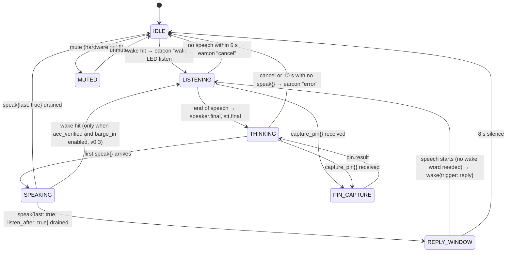

# Voice pipeline

> Status: Draft spec · 2026-11-01 · Applies to: M0, v0.1 (v0.2+ appears only as invariants; see [ROADMAP](ROADMAP.md))

Everything that touches PCM audio in beepboop: the microphone array, wake word, VAD and endpointing, speaker identification, enrollment, STT, TTS, earcons and LEDs, mute, spoken-PIN capture, the system phrases the device speaks, and the audio-side rows of the latency budget. All of it runs inside the `beepboop-audio` container (python package `beepboop_audio`); only text events cross to `beepboop-core`. Every number not yet measured on a Pi 4 is a **target**; milestone M0 exists to measure them.

Related: [ARCHITECTURE](ARCHITECTURE.md) · [IDENTITY_AND_TRUST](IDENTITY_AND_TRUST.md) · [DATA_AND_PRIVACY](DATA_AND_PRIVACY.md) · [LLM_PROVIDERS](LLM_PROVIDERS.md) · [OPERATIONS](OPERATIONS.md) · [ROADMAP](ROADMAP.md) · [GLOSSARY](GLOSSARY.md) · ADRs [0003](adr/0003-local-first-speech.md), [0006](adr/0006-voice-id-is-personalization.md), [0008](adr/0008-audio-core-process-split.md), [0009](adr/0009-microwakeword-and-sherpa-onnx.md), [0014](adr/0014-second-factor-web-confirm.md), [0015](adr/0015-latency-contract-and-fast-path.md), [0018](adr/0018-no-audio-retention.md) · research: [wake-speaker](research/wake-speaker.md), [stt-tts-audio](research/stt-tts-audio.md)

---

## 1. Principles

1. **Audio never crosses a process boundary.** `beepboop_audio` owns capture, playback and every model that consumes or produces PCM; core sees text and numbers. ([ADR 0008](adr/0008-audio-core-process-split.md))
2. **One runtime.** sherpa-onnx 2.0.1 runs VAD, speaker embedding, STT and TTS. microWakeWord (`pymicro-wakeword` 2.5.0) is the one exception: no sherpa-onnx wake model exists for our phrase. ([ADR 0009](adr/0009-microwakeword-and-sherpa-onnx.md))
3. **Local by default, cloud by opt-in.** Everything here works with the network unplugged except the LLM turn, which the deterministic fast path covers for common device commands. Cloud STT/TTS are v0.2 plugins, off by default. ([ADR 0003](adr/0003-local-first-speech.md))
4. **Voice ID is personalization, not authentication.** It picks a profile and never unlocks a `critical` action on its own. ([ADR 0006](adr/0006-voice-id-is-personalization.md))
5. **Every model stage is a provider behind a small Protocol** (§17), registered by entry point, with a conformance suite. Silero VAD is the one fixed internal component.
6. **No audio is kept. No exceptions.** PCM lives in RAM for the duration of a turn and is gone at its end. Enrollment keeps embeddings, never clips, so a speaker-model change means re-enrolling (about two minutes per person). No debug retention, no stored wake clips. ([ADR 0018](adr/0018-no-audio-retention.md), [DATA_AND_PRIVACY §7](DATA_AND_PRIVACY.md#7-retention-defaults))
7. **Locale is carried end to end.** v0.1 ships English models only, but every event, profile and provider call carries a BCP-47 `locale`, so a new language is a model download, not a refactor.

---

## 2. Hardware and ALSA

### 2.1 Required hardware

| Part | Requirement | Why |
|---|---|---|
| Raspberry Pi 4 | 8 GB recommended, 4 GB minimum, 64-bit Raspberry Pi OS Lite | HA + STT + TTS + speaker ID do not fit in 2 GB. |
| Storage | USB 3 SSD (boot from it) | HA's recorder wears out SD cards. |
| Cooling | Active fan or fan case | Sustained STT + TTS throttles a passive Pi 4. |
| Microphone | **ReSpeaker XVF3800 USB 4-mic array**, **16 kHz USB firmware** (pinned image, [OPERATIONS §1](OPERATIONS.md#1-bill-of-materials)) | On-chip AEC, beamforming, NS, AGC, DoA. |
| Speaker | Powered speaker on the array's audio output | **All playback must leave through the array**: its playback stream is the AEC reference. |

Other USB microphones work for development with `aec_verified: false` (no barge-in; wake detection suspended during playback). They are not supported in production.

### 2.2 Firmware and channel map

The 16 kHz USB image exposes a 6-channel capture device. beepboop uses **channel 0, the processed ASR beam** (AEC + beamforming + NS + AGC), for wake word, VAD, speaker ID and STT alike; enrolling and identifying on the same processed channel matters because the DSP changes the voice. Channel 1 is the comms beam (unused); channels 2–5 are raw mics, read only by `beepboop bench aec`. The map is confirmed in M0 (ROADMAP V3).

### 2.3 ALSA in the container

The audio container gets `/dev/snd` and talks raw ALSA; no PipeWire or PulseAudio sits in the path. The compose shape is owned by [OPERATIONS §3](OPERATIONS.md#3-compose-layout); the one ALSA env var is `BB_ALSA_DEVICE` ([ARCHITECTURE §9](ARCHITECTURE.md#9-configuration-model)). Rules:

- **One capture stream** (S16_LE, 16 kHz, 6 ch, period 160 frames = 10 ms) and **one playback stream** (S16_LE, 16 kHz, 2 ch, period 320 frames = 20 ms, 4 periods ≈ 80 ms) on the same device. Everything that plays is mixed in-process (§11.4) into that one stream: no `dmix`, no second opener.
- If the playback endpoint requires 48 kHz (M0 check), the service resamples with `soxr` at the last step; the internal rate stays 16 kHz.
- 10 ms is the common denominator: microWakeWord strides at 10 ms, Silero VAD consumes 32 ms windows, the zipformer takes any chunk size.
- Device loss (USB unplug) is fatal and restarts the container; on restart the service plays the `ready` earcon.

### 2.4 Verifying the AEC reference (M0, blocks barge-in)

Seeed does not document the reference routing. `beepboop bench aec` plays a 10 s TTS clip through the array while a speaker at 2 m says the wake word five times, and compares wake-hit rate and STT WER against the same utterances in silence (pass criteria in §15.2). The result is stored as `aec_verified` in the household table, reported in `hello` and every `health`, and shown on System › Voice.

---

## 3. Frames, clocks and the ring buffer

| Constant | Value | Rationale |
|---|---|---|
| Sample format | PCM16 mono, 16 000 Hz, little-endian | Native rate of the firmware, the wake model, CAM++, zipformer and Piper low voices. |
| Capture frame | 160 samples = 10 ms | Shared stride of wake features and endpointing. |
| Ring buffer | 3.0 s (48 000 samples), RAM only | Holds the wake-word pre-roll plus slack; cleared on mute and at end of turn. |
| Pre-roll handed to speaker ID | 1.2 s ending at `t_wake` | Covers "Hey beepboop" (~0.7–0.9 s) plus the onset. |
| Max utterance | 15 s | Hard stop; longer speech is cut with the `too_long` earcon. |
| Clock | `time.monotonic_ns()` at the capture callback, one `t_frame` per frame | All stage times are deltas from these stamps, never wall clock. |

Every PCM frame carries its capture stamp through the pipeline, and events carry the stamps they were derived from (`t_wake`, `t_speech_start`, `t_eos`, `t_final`, `t_first_audio`), so core builds the per-turn latency waterfall without asking the audio service anything.

**Thread budget.** This table is the single source for thread counts; [ARCHITECTURE §11](ARCHITECTURE.md#11-concurrency-model) and the `audio.threads` config key follow it. The container is pinned to cores 2–3; HA and core share cores 0–1.

| Work | Threads | Rule |
|---|---|---|
| Capture + wake word + VAD | 1 pinned real-time thread | The only always-on inference; must return within each 10 ms frame. |
| STT (zipformer) | 2 | Decodes every 100 ms of audio; overlaps speaker embedding only in the end-of-speech flush window. |
| Speaker embedding (CAM++) | 2 | Never concurrent with TTS. Runs the provisional and the speculative final embedding (§7.3). |
| TTS (Piper via sherpa-onnx) | 2 | Starts after `stt.final`; shares cores with STT but not in time (barge-in, v0.3, is the exception). |

sherpa-onnx is created with `allow_spinning=0` everywhere so idle threads sleep.

---

## 4. Pipeline state machine



`IDLE` is the only state in which wake detection is armed in v0.1; `REPLY_WINDOW` is the one hands-free exception (§15.1).

### 4.1 One turn, end to end

The full lifecycle, including core's side, is [ARCHITECTURE §5](ARCHITECTURE.md#5-turn-lifecycle). Audio-side: wake hit → `wake` earcon and event → provisional embedding of the pre-roll → `speaker.provisional` → zipformer stream with the household and provisional profile's hotwords → `stt.partial`s → speculative final embedding at 100 ms of silence → hangover → `speaker.final`, then `stt.final` → `speak{seq}` sentences played in order → `speak.done`. Core never executes a tool before `speaker.final`; because the final ID is computed in parallel with STT (§7.3) this costs nothing. If `speaker.final` has not arrived 300 ms after `stt.final`, the turn runs as guest and this is logged.

---

## 5. Events between audio and core

Transport, envelope and the event catalog are defined once in [ARCHITECTURE §4](ARCHITECTURE.md#4-audio--core-event-protocol). This section says only *when* each audio-side event fires:

- `wake` is sent before anything else after a hit; the `wake` earcon plays in parallel (§13.1). `turn_id` is minted by audio (ULID) and reused by every event of the turn.
- `speaker.provisional` follows ~100 ms after `wake` (target), from the pre-roll alone.
- `stt.partial` is throttled to one per 200 ms and exists for the UI live view only.
- `speaker.final` is always sent, even when it equals the provisional result, and always before `stt.final`.
- `stt.final{empty: true}` means no speech followed the wake word; core ends the turn silently or with `speak{clip: "cancel"}`.
- `speak` arrives one sentence at a time (§11.2); the service synthesizes in `seq` order and reports `speak.done` once per `utterance_id` with `t_first_audio` and `t_last_audio`; an utterance is complete when its `last: true` sentence has played or the next `speak` of the turn carries another `utterance_id`. When `last: true` and `listen_after: true`, the reply window opens. `speak{clip: "alarm"}` starts the alert lane (§11.4) and is reported done at once; `cancel` for that turn stops it.
- `cancel` flushes the speech lane for that turn, plays the `cancel` earcon and returns to `IDLE`.
- `capture_pin` / `pin.result`: §12. `pin.result` never contains digits.
- `mic.state` is sent on every mute change; `mute` is only ever received (§13.2).
- `health` is sent on connect and every 10 s and carries `aec_verified` (always `false` in v0.1: the `bench aec` result lives in core's database and gates only barge-in, v0.3). `cpu_temp_c` is `-1.0` on a host without a thermal sensor.
- A reply-window turn (`wake{trigger: "reply"}`) has no `speaker.provisional`: there is no wake phrase to embed.

---

## 6. Wake word: "Hey beepboop"

### 6.1 Engine

microWakeWord through `pymicro-wakeword` 2.5.0 (Apache-2.0, aarch64 wheels): a streaming MixConv TFLite network over 40-bin mel features at a 10 ms stride, evaluated every 30 ms, running **synchronously inside the capture thread**. Target cost ≤ 8 % of one A72 core. openWakeWord is a plugin (`beepboop.wake_providers` entry point `openwakeword`) for people who already have a model; its pretrained models are CC BY-NC-SA and are not shipped. Porcupine is excluded (free tier ended 2026-06-30).

### 6.2 Detection parameters

Keys and defaults are in §17.1: `probability_cutoff: 0.97` (target; tuned on the soak corpus in M0), `sliding_window_size: 5` (consecutive 30 ms windows averaged), `refractory_ms: 2000`, `vad_gate: true` (Silero speech probability ≥ 0.5 in the last 300 ms). A **hit** fires when the sliding-window mean exceeds the cutoff and the VAD gate is satisfied; `t_wake` is the capture stamp of the frame that crossed the threshold.

### 6.3 Acceptance targets

The gate is [ROADMAP G5](ROADMAP.md#m0-prove-the-pi): ≤ 0.5 false accepts per 24 h on the soak corpus, ≤ 5 % false rejects at 3 m in a quiet room. Non-gated targets the bench also reports: false rejects ≤ 15 % with a TV at 60 dB SPL, hit latency ≤ 200 ms after the end of "boop", CPU ≤ 8 % of one core. Error rates are reported **per speaker** so a model that works for adults and fails for children is visible.

### 6.4 Training pipeline: `tools/train_wakeword/`

The shipped model is reproducible from this directory; each step is a `make` target with a pinned Python environment, and the [README there](../tools/train_wakeword/README.md) is the runbook. `make synth` generates ~20 000 positive clips with the Piper sample generator across ≥ 40 voices, speeds 0.8–1.3 and three phoneme spellings (`hˈeɪ bˈiːpbuːp`, `…bˈiːp bˈuːp`, a clipped `…bipbup`), plus TTS near-misses ("hey people", "beat loop", "he bumped", "hey, be quick") as hard negatives. `make negatives` downloads licence-clean corpora (CC BY, CC0, Apache-2.0: LibriSpeech, Speech Commands, VOiCES, MUSAN, OpenSLR 28, FSD50K filtered to CC0/CC BY clips) and the training step builds its own negative features from them. `make augment` applies pitch shifts (Piper has no pitch control), convolves with public RIRs, mixes household-like noise (MUSAN and the other licence-clean sets; no AudioSet, whose audio has no redistribution licence) at 0–25 dB SNR and applies the array's measured frequency response (one M0 sweep). `make train` runs microWakeWord's trainer; `make export` writes TFLite int8 with a `hey_beepboop_vN.json` (cutoff, window). `make eval` reports false-reject and false-accept *estimates* on held-out synthetic clips and ambient audio and recommends a cutoff; it fails only with `--require-targets`, because the §6.3 targets are G5 numbers that only the soak corpus can produce. microWakeWord's pre-generated negative features are CC BY-NC (CHiME-6, WHAM!) and are used only by `--profile research`, which never exports a shippable model. The licence of every voice, dataset, RIR and noise set lives in [tools/train_wakeword/DATA_LICENSES.md](../tools/train_wakeword/DATA_LICENSES.md) (checked by `train-wakeword check`), and the model's `models/manifest.yaml` attribution points there. The LibriTTS-R generator and several of the voices are fine-tuned from the research-only Blizzard 2013 Lessac voice; the owner accepted that provenance for this personal/research project on 2026-11-03 (D1, [ADR 0020](adr/0020-gpl-3-and-espeak-phonemiser.md)), and a strict profile without them stays documented in the README. The Pi itself never trains.

### 6.5 False-wake review (v0.2 at the earliest)

Not in v0.1: it would store audio (§1 rule 6). An opt-in, encrypted, bounded false-wake queue may be proposed for v0.2 via a new ADR ([ROADMAP v0.2](ROADMAP.md#v02-your-accounts-your-devices)). In v0.1 "Report false wake" in Activity marks the turn only; no clip exists to review.

---

## 7. VAD and endpointing

### 7.1 VAD

Silero VAD (ONNX) through `sherpa_onnx.VoiceActivityDetector`, 32 ms windows, speech threshold 0.5. A fixed internal component, not a provider: it runs continuously (it gates wake detection) and is the authority for **speech start** and **end of speech (EOS)**. Target cost ≤ 3 % of one core.

### 7.2 Endpointing rules

| Rule | Value (target) | Effect |
|---|---|---|
| Speech-start timeout | 5 s after `t_wake` | No speech → `cancel` earcon, `stt.final{empty: true}`, back to IDLE. |
| Minimum speech | 300 ms | Shorter blips (a cough) are ignored. |
| **Hangover** | **250 ms** of VAD silence after speech | Primary EOS trigger; the biggest knob in the latency budget. |
| Adaptive hangover | 400 ms when the last `stt.partial` ends in a function word (`and`, `to`, `the`, `at`, `in`) or a number | Cuts "set a timer for… [pause] ten minutes" truncation. Vocabulary per locale in `audio/beepboop_audio/pipeline/endpoint/<lang>.yaml`. The extra 150 ms visibly consumes budget (§14). |
| STT endpoint backstop | zipformer `rule2_min_trailing_silence = 0.6 s`, `rule1 = 2.0 s`, `rule3_min_utterance_length = 15 s` | Fires if VAD misses (music bed, HVAC noise). |
| Max utterance | 15 s | Cut with `too_long`; transcript so far is sent as final. |

`t_eos = t_last_speech_frame + hangover`; the STT final tail (§10.1) starts at `t_eos`. M0 sweeps hangovers of 200/250/300/400 ms on the fixture set and picks the smallest with < 2 % truncation (`bench endpoint`).

### 7.3 Speculative final embedding

The final speaker embedding (§8.2) must be ready at EOS without adding to the budget. The service starts it **speculatively** when VAD has seen 100 ms of silence after speech, on the pre-roll plus the first ≤ 2 s of command. If speech resumes before the hangover expires, the result is discarded and redone at the next 100 ms of silence. In the common case the embedding finishes within the remaining 150 ms of hangover, so `speaker.final` precedes `stt.final` at zero added latency. `bench speaker --latency` reports `t_speaker_final − t_eos` (≤ 0 ms at p50) and the embed wall time against [ROADMAP G1](ROADMAP.md#m0-prove-the-pi).

---

## 8. Speaker identification

### 8.1 Model

CAM++ (WeSpeaker English VoxCeleb, 512-d as exported for sherpa-onnx (measured 2026-11-02, [models/LICENSES.md](../models/LICENSES.md)), 7.18 M params, 1.72 GFLOPs, 0.73 % EER VoxCeleb1-O) through `sherpa_onnx.SpeakerEmbeddingExtractor`, **fp32**, 2 intra-op threads; int8 is the G1 fallback experiment, not the default. No int8 CAM++ export exists in the sherpa-onnx releases (`bench speaker` reports `int8: null`), so the experiment starts by making one: onnxruntime dynamic quantization of the pinned fp32 model, recorded in `models/manifest.yaml` as its own entry with its sha256, then the household EER A/B. The `SpeakerProvider` Protocol (§17) is model-agnostic, and the event protocol takes the length from `hello.speaker.dim` rather than fixing it ([ARCHITECTURE §4.4](ARCHITECTURE.md#44-framing-and-validation-rules)); `{model_id, model_sha, dim}` is stored with every embedding, and because no audio is kept, **a model change forces re-enrollment**: core marks every voiceprint stale, everyone is identified as Guest until re-enrolled, and the UI explains why and offers the two-minute flow ([ADR 0018](adr/0018-no-audio-retention.md)). Estimated cost for 2 s of audio: 60–130 ms fp32 (scaled from the paper's x86 RTF; **unmeasured**). Gate: ROADMAP G1.

### 8.2 Two-stage identification

- **Provisional**, ~100 ms after `t_wake` (target), from the 1.2 s pre-roll containing "Hey beepboop". The wake phrase is **text-dependent**: everyone says the same words, so a sub-second sample is far more discriminative than free speech. It lets core pre-warm the profile's vocabulary, Bedrock connection and tool list.
- **Final**, from the pre-roll plus the first ≤ 2 s of the command, computed speculatively at 100 ms of VAD silence (§7.3) or at 2 s of speech, always before `stt.final`. Policy decisions and tool execution wait for this.

Fusion: `score_final = 0.4 · score_wake + 0.6 · score_cmd` per candidate on AS-normalized scores (weights are an M0 calibration target). If the command segment is shorter than 0.5 s, the final uses the wake score alone and `audio_ms` tells core how little it had.

### 8.3 Scoring

1. **Centroids.** Each profile has `k ≤ 4` unit-vector centroids from k-means over its enrollment embeddings (plus, from v0.2, its adaptation buffer), `k` by silhouette score. A split is kept only when its silhouette exceeds 0.1, each cluster has ≥ 3 clips and no two centroids have cosine > 0.9 (targets; otherwise `k = 1`). Core computes them when enrollment finishes (`DbVoiceprintSink` in `core/beepboop/audio_bridge.py`). Enrollment embeddings are the **anchor set** and always participate.
2. **Raw score.** `s(p) = max_j cos(e, c_{p,j})` per enrolled profile `p`.
3. **AS-norm.** Adaptive symmetric normalization against a cohort of ~200 embeddings: the other household members' centroids plus a bundled cohort (`models/speaker/cohort_<model_id>.npy`, synthesized from licensed Piper voices through the array's response so no third-party speech is redistributed; §18). Top-N = 50. Result: a z-score `z(p)`.
4. **Calibration.** At enrollment (§9.3) each household fits a logistic map from genuine and impostor `z` distributions to a **calibrated confidence** `conf(p) ∈ [0,1]`. In events, `score = conf(top1)` and `margin = conf(top1) − conf(top2)`; this is the `confidence` on the Principal ([IDENTITY_AND_TRUST §3](IDENTITY_AND_TRUST.md#3-the-principal)). The household fit reaches audio as the per-profile thresholds in `profiles.sync.calib`; the map itself uses default parameters `conf = σ(1.5·z − 3)` (targets: z = 2.6 → 0.70, z = 3.5 → 0.90). Until the bundled cohort exists, AS-norm uses the household's own centroids when there are ≥ 10, else fixed impostor statistics (μ = 0.10, σ = 0.10, targets); all are refitted in M0 (`bench speaker`).

### 8.4 Accept rule and per-tier thresholds

```
identity = top1   if conf(top1) ≥ τ_tier  and  margin ≥ m_tier
         = guest  otherwise
```

The audio service emits `profile_id` using the `act` thresholds and includes `score` and `margin`, so core's policy middleware applies the stricter per-tier rule to each tool call. One identification, many thresholds, no second embedding.

**This table owns the default numbers.** They are written into `voiceprints.calib_json` at enrollment ([DATA_AND_PRIVACY §6.1](DATA_AND_PRIVACY.md#61-v01-tables-0001_initsql)), then calibrated per household to target FAR ≈ 5 % at `act` and ≈ 1 % at `personal`. [IDENTITY_AND_TRUST §4](IDENTITY_AND_TRUST.md#4-risk-tiers) links here rather than restating them. They are **initial defaults to be validated in M0**.

| Tier | τ (conf) | m (margin) | What core does below threshold |
|---|---|---|---|
| `read` | 0.50 | 0.00 | Still answers, as Guest if Guest has the grant. |
| `act` | 0.70 | 0.10 | Acts as Guest if Guest has the grant; otherwise speaks `unknown_speaker` (§11.6). |
| `personal` | 0.90 | 0.20 | Second factor ([IDENTITY_AND_TRUST §8](IDENTITY_AND_TRUST.md#8-second-factor)); the device speaks `personal.unsure`. A spoken "yes" never changes a policy decision. |
| `critical` | as `personal` | as `personal` | **Always** the second factor, regardless of score. |

System › Voice shows the calibrated values with the measured FAR/FRR at each setting. Children's profiles cannot be granted anything above `act`, so the `personal` threshold never applies to them.

### 8.5 Guest fallback

Guest is a real profile with its own grants and stores nothing about the speaker ([DATA_AND_PRIVACY §8](DATA_AND_PRIVACY.md#8-guest)). TV voices that pass the wake word end up here, which is why Guest's default grants are conservative.

### 8.6 Presence prior (v0.2)

Invariants fixed now ([ROADMAP v0.2](ROADMAP.md#v02-your-accounts-your-devices)): applied in core's policy layer from `speaker.final.candidates`, never inside the audio service, so the emitted `profile_id` stays prior-free; shifts `τ` by at most ±0.05 per profile from HA `person` presence only, and a profile marked away leaves the candidate set unless it scores ≥ 0.95; never lowers the `personal` or `critical` requirement; logged on the turn so Activity can say "nudged by presence".

### 8.7 Adaptation

Adaptation ships in **v0.2** ([ROADMAP v0.2](ROADMAP.md#v02-your-accounts-your-devices)); v0.1 only **writes** the buffer so there is data to validate against. Invariants:

- A turn's final embedding enters the profile's adaptation buffer (`voice_samples.kind = 'adapt'`, ≤ 50 per profile, FIFO) only when `conf(top1) ≥ 0.95` (children 0.90), `margin ≥ 0.30`, speech ≥ 1.5 s, and no correction ("that wasn't me", a `personal` denial, a failed PIN) follows within 10 minutes. Never from Guest, never from reply-window turns (`anchor: false`).
- Centroids and the calibration map are recomputed nightly by the core scheduler ([ARCHITECTURE §11](ARCHITECTURE.md#11-concurrency-model)) or on demand; enrollment embeddings are never evicted.
- Children's voices drift (adult-trained models show ~30 % EER on young children); the v0.2 nightly job tracks their 30-day mean genuine score and prompts the parent to re-enroll on a 0.10 drop or after 90 days.

### 8.8 "That wasn't me"

This section is the single definition; [IDENTITY_AND_TRUST §10](IDENTITY_AND_TRUST.md#10-parental-view-of-child-history) and the Web UI link here.

Two entry points: by voice, "Hey beepboop, that wasn't me" (the `not_me` fast-path intent, [LLM_PROVIDERS §12.1](LLM_PROVIDERS.md#121-what-it-covers-v01-en); applies to the previous turn on this device within 5 minutes; acknowledged with the `not_me` phrase, §11.6), or the one-tap button in Activity and on an approval banner. One effect:

1. The turn is flagged `misattributed` (`turns.flagged`).
2. `turns.corrected_profile_id` is set to `guest` unless an admin picks a person in the UI.
3. The turn's embedding is removed from the adaptation buffer and stored as a **negative example** for the misattributed profile (`voice_samples.kind = 'negative'`, an impostor sample in calibration).
4. An audit row is written; if the turn executed anything above `read`, the admin sees it flagged in Activity.
5. The correcting voice is itself identified. If the corrector is neither the attributed profile nor an admin, the correction is **disputed**: the flag is kept for the admin, but steps 2–3 are not applied.

---

## 9. Enrollment

### 9.1 Consent

Enrollment starts in the Web UI with the consent screen owned by [DATA_AND_PRIVACY §9.1](DATA_AND_PRIVACY.md#91-biometric-consent). For a `child` profile an admin must be the logged-in user. Guests are never enrolled.

### 9.2 Flow

The browser drives; **the Pi's own array records** (`enroll.start` / `enroll.clip`). A phone mic is a different channel and would hurt accuracy, so the UI never uploads audio. Each clip is embedded as soon as it passes its gate and the PCM is discarded; only the embedding and quality numbers cross to core.

| Step | Prompt | Clips | Quality gate |
|---|---|---|---|
| 1 | "Stand about where you usually talk to beepboop. Say **Hey beepboop** when the ring turns blue." | 5 wake-word clips | Wake model must fire on the clip (text-dependent sample); ≥ 0.6 s speech. |
| 2 | "Now from across the room." | 3 wake-word clips | Same. |
| 3 | "Read these sentences." (5 prompted sentences covering the phoneme space, ~5 s each) | 5 free-speech clips | Duration ≥ 1 s; VAD speech ratio ≥ 0.6. |
| 4 | "From the kitchen / doorway, read two more." | 2 free-speech clips | Same. |
| child profiles | Steps 1–4 with 8 + 5 + 8 + 3 clips | | Same gates; a progress ring makes it feel like a game. |

Total ≈ 40–60 s of speech, about two minutes wall time. Every clip is checked immediately and re-prompted if it fails (targets): SNR ≥ 15 dB against the 500 ms before the clip ("It's a bit noisy — can you pause the TV?"), clipping < 0.1 % of samples ("A little quieter, or step back a bit."), VAD speech ratio ≥ 0.6 ("I didn't catch that — try again."), cosine to the running mean of accepted clips ≥ 0.55 ("That sounded different — was that you?", accepted on the second try to allow genuine variety).

### 9.3 Similarity check and feedback

After the last clip, the service computes the profile's centroids, the household **similarity matrix** (max cosine between any two profiles' centroids) and the per-household calibration (§8.3). Any pair with similarity ≥ 0.70 triggers the warning "Alex and Sam sound similar; beepboop will ask before doing anything personal for either of you" and raises `m_personal` for the pair to 0.25. A "test from the couch" button identifies live and reports the score. Screen layout: [WEB_UI §5.3](WEB_UI.md#53-people-and-voice-enrolment).

### 9.4 Storage and model changes

Only embeddings are stored: `voiceprints` (centroids, calibration, consent) and `voice_samples` (per-clip embeddings), envelope-encrypted, schema in [DATA_AND_PRIVACY §6.1](DATA_AND_PRIVACY.md#61-v01-tables-0001_initsql). No enrollment audio is kept, so a speaker-model upgrade means re-enrolling (§8.1). Core decrypts centroids only to send them in `profiles.sync`; the audio service holds them in memory only.

---

## 10. Speech-to-text

### 10.1 Default: streaming zipformer (`sherpa-zipformer`)

`sherpa_onnx.OnlineRecognizer` with a streaming zipformer transducer (English, ~20 M params class, int8), `decoding_method: modified_beam_search` (required for hotwords), `max_active_paths: 4`, 2 intra-op threads. Model files are downloaded at install and pinned by sha in `models/manifest.yaml`.

Audio is fed in 10 ms frames; decoding runs every 100 ms of accumulated audio; `stt.partial` is emitted at most every 200 ms. At `t_eos` the stream is flushed with 0.3 s of synthetic silence (the model needs right context) and the final result is taken. **Target: final tail ≤ 100 ms after `t_eos`; RTF ≤ 0.6 at 2 threads with HA running and the speaker embedding overlapping in the flush window** ([ROADMAP G2](ROADMAP.md#m0-prove-the-pi)).

### 10.2 Per-profile hotword biasing

**BPE model (M0 finding 2026-11-03, resolved 2026-11-04).** sherpa-onnx hotwords for an English BPE transducer need `modeling_unit: bpe` plus a `bpe.vocab`. The pinned zipformer archive ships only `tokens.txt`, so the `bpe.model` of the icefall recipe it was trained with (LibriSpeech `lang_bpe_500`, unigram, 500 pieces equal to `tokens.txt`) is pinned as its own manifest entry, `icefall-librispeech-bpe-500`, at a fixed Hugging Face commit with its sha256. `beepboop_audio/stt/sherpa_zipformer/bpe.py` reads it without a `sentencepiece` dependency: it renders the `bpe.vocab` text that the recognizer reads once at load (from a temporary file deleted right after) and drops phrases the vocabulary cannot encode (digits, symbols). Phrases are passed upper-cased, the vocabulary's case. Without the file installed the stream runs unbiased. Biasing is shown to work on a LibriSpeech test clip (conformance test, x86); the hotword WER delta in `bench stt` is still **pending** (bench work, on the fixture corpus).

Contextual biasing (`hotwords_score: 1.5`, target) with a list rebuilt by core whenever a profile's grants, contacts, lists or timers change, pushed in `profiles.sync`: HA entity and area names the profile can reach (friendly names and aliases), household member names, list names and recent items, timer and alarm labels, and module-declared vocabulary (`manifest.yaml: vocabulary:`). Cap 200 entries per list, phrases ≤ 4 tokens, deduplicated, lower-cased and converted to BPE tokens at build time. The household-wide list travels as the `hotwords` of the `guest` row of `profiles.sync` (a row with no centroids); each profile's row carries its personal list. **Built in v0.1** (`build_profiles_sync`, `core/beepboop/audio_bridge.py`): member names and HA area names (household) and the names and aliases of the entities each profile can reach (personal); list names and items, timer labels and module `vocabulary:` are not collected yet, and the lists are rebuilt on connect and after an enrollment, not yet on every grant change. The stream is created at `t_wake` with `household ∪ provisional_profile` once `speaker.provisional` is known (if late, the household list alone) and is never recreated mid-utterance.

### 10.3 Alternative providers (v0.2)

`sherpa-zipformer` is the only STT provider in v0.1. Invariants for the v0.2 plugins ([ROADMAP v0.2](ROADMAP.md#v02-your-accounts-your-devices)): `deepgram` (Nova-3, streaming) and `wyoming` (any LAN Wyoming STT server; no auth, LAN only) implement the same `SttProvider` Protocol; one provider is active per utterance with no automatic second pass; a cloud provider falls back to `sherpa-zipformer` when offline with one "working offline" notice per outage; `stt.final.provider` names which one ran. Configuration and egress: §17.1.

### 10.4 Locale

`locale` comes from the identified profile (`profiles.locale`), falling back to the household default. In v0.1 only `en-*` models are installed; a profile with another locale gets English STT and a note in the UI. Model selection is a lookup in `models/manifest.yaml`.

---

## 11. Text-to-speech

### 11.1 Default: Piper voices in sherpa-onnx (`sherpa-piper`)

Pipeline: text → normalise (numbers, units, times) → `piper-phonemize` (espeak-ng, reading the voice's `espeak-ng-data`) → phoneme codepoints → `sherpa_onnx.OfflineTts` running the Piper-format VITS voice (`*.onnx` + `tokens.txt`) via `GenerationConfig.phoneme_codepoints` → PCM. sherpa-onnx ≥ 2.0 has no built-in espeak-ng frontend for Piper voices, so phonemisation happens in beepboop-audio (`beepboop_audio/tts/sherpa_piper/phonemize.py`); `piper-phonemize` 1.5.9 is a pinned audio dependency with cp312 wheels for aarch64, x86_64 and Windows. It wraps espeak-ng (GPL-3.0), which the project's GPL-3.0-or-later licence allows ([ADR 0020](adr/0020-gpl-3-and-espeak-phonemiser.md)); sherpa-onnx is Apache-2.0. Each voice's licence is recorded in `models/LICENSES.md`. The default voice `en_US-lessac-low` is trained on the research-only Blizzard 2013 Lessac corpus; the owner accepted it for this personal/research project on 2026-11-03 (D1); a deployment that needs a clean dataset licence swaps the voice in `models/manifest.yaml`.

| Setting | Default | Notes |
|---|---|---|
| Household voice | `en_US-lessac-low` until M0 picks | Low voices are 16 kHz native; medium are 22.05 kHz, resampled with `soxr`. `bench tts` decides whether `medium` meets the first-chunk target. |
| Per-profile voice | `profiles.tts_voice` | Children often get a different voice; personas may override. |
| Per-profile rate | `profiles.speech_rate` 0.7–1.4 → VITS `length_scale = 1 / rate` | "Speak slower" is the `speech_rate` fast-path intent ([LLM_PROVIDERS §12.1](LLM_PROVIDERS.md#121-what-it-covers-v01-en)). |
| Threads | 2 (§3) | Never concurrent with speaker embedding. |

### 11.2 Sentence chunking

Core owns chunking: it splits the LLM stream on sentence boundaries (`.?!;:` followed by space, plus a 120-character soft limit) and sends one `speak{seq}` per sentence as soon as it is complete. So that the final sentence can carry `last: true`, the newest complete sentence is held until the next one starts or the stream ends (one token of delay, never a whole sentence). The audio service synthesizes in order, starts playback on the first sentence's first PCM chunk, and keeps synthesizing the next sentence while the current one plays. **Target: first audio ≤ 200 ms after the first `speak` arrives** (G6 stage check, 12-word sentence).

Number, unit and abbreviation normalization happens in the audio service before synthesis (`audio/beepboop_audio/tts/normalize_<locale>.py`): "10:30" → "ten thirty", "72°F" → "seventy-two degrees", "Dr." → "doctor". The LLM is told to write for the ear ([LLM_PROVIDERS §7](LLM_PROVIDERS.md#7-voice-system-prompt-contract)); normalization is the backstop.

### 11.3 Cached clips and earcons

At startup, and whenever a profile's voice or rate changes, the service pre-renders a **clip set** per active voice and rate, held in RAM only (no cache file, so a filesystem scan for audio bytes is unambiguous): every system phrase in §11.6 that has no `{placeholder}`, the short acks "Done.", "OK.", "Sure.", "Cancelled.", "Timer set.", and the claim-code digits 0–9 ([WEB_UI §5.1](WEB_UI.md#51-first-run-onboarding)). The ack keys are `done`, `ok`, `sure`, `cancelled` and `timer_set`. Which keys `speak{clip}` accepts, and what happens with an unknown one, is defined once in [ARCHITECTURE §4.2](ARCHITECTURE.md#42-event-catalog) (clip keys). Beyond the fixed set, an LRU of 200 recently synthesized sentences per voice makes repeated answers ("It's 7:30") instant. Entries are PCM16 16 kHz and total well under 50 MB; they are synthesized outputs, not captured audio, and are rebuilt after a restart.

### 11.4 Playback mixer

One playback stream, three lanes, mixed in software with a 20 ms period:

| Lane | Content | Rule |
|---|---|---|
| `earcon` | state chimes, PIN prompt tone | Plays over anything; never queued. |
| `speech` | TTS and clips for the active turn | FIFO by `seq`; `cancel` flushes it. |
| `alert` | timers, alarms, announcements (`speak{clip: "alarm"}` or text via `ctx.announce`) | Ducks `speech` by −12 dB while active; repeats until acknowledged by voice ("stop"), button or UI (each reaches audio as `cancel` for the alert's turn), at most 5 minutes (target). |

Volume is a household setting plus a per-profile offset; alerts have their own floor so a quiet evening setting does not silence an alarm. Ducking HA media players on wake is a v0.2 core hook, not an audio-service concern.

### 11.5 Cloud TTS (v0.2)

Invariant: Amazon Polly (`polly`) implements the same `TtsProvider` Protocol, streams PCM 16 kHz, falls back to Piper when offline, and is listed on the privacy ledger even though TTS sends text only. Configuration: §17.1.

### 11.6 System phrases (normative)

The fixed sentences the device speaks on behalf of policy and the turn loop. Core sends them by key (`speak{clip: "<key>"}`) or with placeholders filled (`speak{text}`); the audio service pre-renders every placeholder-free key (§11.3). [IDENTITY_AND_TRUST](IDENTITY_AND_TRUST.md) and [WEB_UI](WEB_UI.md) refer to these keys rather than their own wording. The persona module may restyle them per household, but the meaning and the two rules at the end are fixed.

| Key | Text (en-US default) | When |
|---|---|---|
| `claim.code` | "Your setup code is {d1} {d2} {d3} {d4} {d5} {d6}." | First run, spoken digit by digit ([WEB_UI §5.1](WEB_UI.md#51-first-run-onboarding)). |
| `claim.fingerprint` | "My certificate fingerprint starts {f1} {f2} {f3} {f4} {f5} {f6}." | Right after `claim.code`: the first six byte-groups of the Tier-0 CA fingerprint, so the person compares them with `/ca` out of band ([WEB_UI §7](WEB_UI.md#7-https-tiers)). |
| `approval.prompt` | "To {summary}, approve on your phone." | Policy returned `confirm(["web"])`. |
| `approval.prompt_pin` | "To {summary}, approve on your phone, or say your PIN." | `confirm(["web", "pin"])`; the profile has a PIN. |
| `approval.waiting` | "Still waiting for your phone." | Once, when the approval window is extended ([IDENTITY_AND_TRUST §8](IDENTITY_AND_TRUST.md#8-second-factor)). |
| `approval.done` | "Done. {summary_past}." | Approval executed ("Done. Front door unlocked."). |
| `approval.denied` | "Okay, I won't." | The approver tapped the deny button. |
| `approval.expired` | "That approval timed out, so I didn't do it. Ask again when your phone's ready." | `exp` passed with the turn still open. |
| `approval.no_login` | "You haven't set up beepboop on your phone yet. Ask {admin} to send you an invite." | The profile has no web login; followed by `pin.prompt` if a PIN is set. |
| `personal.unsure` | "That sounded like you, {name}, but I'm not sure enough for your {thing}. Approve on your phone, or say your PIN." | `personal` call below `τ_strict`/`m` ([IDENTITY_AND_TRUST §8](IDENTITY_AND_TRUST.md#8-second-factor)). Without a PIN the last clause is dropped. |
| `unknown_speaker` | "I didn't recognise your voice, so I can't do that. If you live here, try again a bit closer." | Guest principal asked for something Guest is not granted. |
| `ceiling.child` | "I can't do that for you, {name}. Ask a grown-up." | `deny(ceiling)` for a `child` profile. |
| `not_granted` | "You don't have access to the {thing}. An adult can change that in the app." | `deny(no_grant)` for an identified profile. |
| `pin.prompt` | "Please say your PIN." | Sent as `capture_pin.prompt`; followed by the `pin` earcon. |
| `pin.mismatch` | "That wasn't it. Approve on your phone instead." | `pin.result{outcome: mismatch}`. |
| `pin.locked` | "Your PIN is locked for a few minutes. Use your phone." | Lockout active ([IDENTITY_AND_TRUST §8](IDENTITY_AND_TRUST.md#8-second-factor)). |
| `offline` | "I can't reach my brain right now, but I can still control the house." | LLM ladder exhausted or no route. |
| `reauth` | "Your {integration} needs reconnecting in the app." | An integration row is in `reauth`. |
| `not_me` | "Okay, noted that wasn't you." | The `not_me` fast-path intent (§8.8). |
| `forget` | "Okay, I've forgotten that." | The `forget_last` fast-path intent ([DATA_AND_PRIVACY §9.3](DATA_AND_PRIVACY.md#93-delete-delete-me-and-delete-this-turn)). |
| `cancel` | "Cancelled." | `cancel` from the user or the `stop` intent, when a reply was in progress. |

Two rules, enforced in core's phrase selection and tested:

1. **Never tell a Guest or unrecognised speaker to approve on a phone.** Guest has no login; the only phrases a guest principal can trigger are `unknown_speaker`, `not_granted`-free refusals and ordinary replies.
2. **Never say tier names aloud.** "act", "personal" and "critical" are spec vocabulary, not speech; phrases name the *thing* ("your calendar", "the front door").

---

## 12. Spoken PIN capture

The default second factor is **Web UI confirm** ([ADR 0014](adr/0014-second-factor-web-confirm.md), [IDENTITY_AND_TRUST §8](IDENTITY_AND_TRUST.md#8-second-factor)). A profile may opt in to a **spoken PIN fallback**, captured and verified entirely inside the audio service, so the digits never reach core, the LLM, the transcript or the turn log. The event contract (`capture_pin` → `pin.result`) is [ARCHITECTURE §4.2](ARCHITECTURE.md#42-event-catalog); length, timeout, attempts and lockout are defined once in the spoken-PIN rules of [IDENTITY_AND_TRUST §8](IDENTITY_AND_TRUST.md#8-second-factor). Audio-side rules:

- On `capture_pin` the service speaks `pin.prompt`, plays the `pin` earcon, sets the LED amber and opens a zipformer stream in `mode: "pin"`: the digit vocabulary ("zero"…"nine", "oh") is strongly biased, no `stt.partial` or `stt.final` is emitted, and the decoded text is discarded after verification.
- At EOS the words are mapped to digits and verified with argon2id against the `pin_hash` core sent (parameters chosen so verification takes ≤ 150 ms on a Pi 4). Common homophones count ("oh", "to", "for", "ate", "won"); any other word is a `mismatch`, silence until `timeout_ms` is a `timeout`. Only `ok | mismatch | timeout | cancelled` is returned; the hash reference is dropped and the digit buffer (a `bytearray`) is zeroed.
- Core enforces lockout and speaks `pin.locked`; a `mismatch` speaks `pin.mismatch`.
- The amber LED tells bystanders a PIN is being spoken; the UI warns that a PIN said in a shared room can be overheard and recommends Web UI confirm.

---

## 13. Earcons, LEDs and mute

### 13.1 State table

The XVF3800 has an RGB LED ring and a mute button driven through the vendor control interface (`xvf_host` / USB control transfers; the exact path is an M0 verification item). If the ring is unavailable the same states drive a single GPIO LED.

**This table owns the earcon name list.** `earcon.name` in [ARCHITECTURE §4.2](ARCHITECTURE.md#42-event-catalog) accepts exactly these names, which are also valid `speak{clip}` keys (clip-key rules: ARCHITECTURE §4.2): `wake`, `ack`, `done`, `prompt`, `cancel`, `error`, `offline`, `pin`, `mute`, `unmute`, `alarm`, `ready`, `too_long`.

| State / moment | Earcon | LED ring | Single LED |
|---|---|---|---|
| `IDLE` | — | off | off |
| `LISTENING` (wake hit) | `wake` — two rising tones, 120 ms | blue, slow breathe; DoA segment brighter | on |
| `THINKING` | — | blue, spinning quarter | slow blink |
| tool call started (LLM turn) | `ack` — one short tone, 80 ms | blue, quick pulse | blink |
| tool finished, nothing to say | `done` — soft two-tone, 100 ms | blue, fade | off |
| `SPEAKING` | — | blue, dim steady | dim |
| `REPLY_WINDOW` | `prompt` — one soft tone, 80 ms | blue, dim pulse | slow blink |
| cancel / no speech | `cancel` — two falling tones, 120 ms | fades out | off |
| error | `error` — low double tone, 150 ms | amber flash ×2 | fast blink ×2 |
| LLM unreachable / no core | `offline` — low single tone, 200 ms | amber, slow fade | fast blink ×3 |
| `PIN_CAPTURE` | `pin` — single mid tone, 80 ms | **amber**, steady | fast blink |
| `MUTED` | `mute` on / `unmute` off, 100 ms | **red**, dim steady | red / on |
| alert (timer, alarm) | `alarm` loop (1 s pattern) | white pulse | blink |
| max utterance reached | `too_long` — three falling tones, 200 ms | blue flash | blink |
| boot / ready | `ready` — three tones, 250 ms | green sweep once | on 1 s |
| claim mode (first run) | spoken digits (`claim.code`) | rainbow sweep | blink pattern of digits |

Earcons are synthesized in-process at start-up from the tone table in `audio/beepboop_audio/pipeline/earcons.py` (sine-based, −12 dBFS, ≤ 250 ms except the 1 s `alarm` pattern, 16 kHz), so there are no asset files and no license question; a household can replace them with a theme directory under `/models/earcons/`. The `wake` earcon plays within 150 ms of `t_wake` (target) and is the first contractual audible feedback of every turn.

### 13.2 Mute

- **Hardware mute** (array button) is honored by the firmware: mic channels go silent. The service also reads the state through the control interface, clears the ring buffer, disarms wake detection, sets the LED red and emits `mic.state{muted: true, source: "hardware"}`.
- **Software mute** comes from the UI, the API or a schedule (quiet hours): core sends `mute{on: true, until?}`; the service behaves identically, plays the `mute` earcon and answers `mic.state{source: "software"}`. Software mute cannot override a hardware mute.
- While muted: no wake processing, no VAD, no ring buffer. Playback still works, so alarms and announcements ring unless the household setting `mute.silence_alerts` is true.
- "Forget the last thing I said" (`forget_last`, [LLM_PROVIDERS §12.1](LLM_PROVIDERS.md#121-what-it-covers-v01-en)) deletes the previous turn's transcript ([DATA_AND_PRIVACY §9.3](DATA_AND_PRIVACY.md#93-delete-delete-me-and-delete-this-turn)); a core feature listed here because users look for it next to mute.

---

## 14. Latency budget

### 14.1 Contract

The contract and how it is measured (clock zero = the last VAD-positive frame; p50 meets, p90 ≤ 1.3×) are owned by [ADR 0015](adr/0015-latency-contract-and-fast-path.md); the gate thresholds are [ROADMAP G1–G7](ROADMAP.md#m0-prove-the-pi). This document adds the stage breakdown. Because the hangover is inside the budget, a 400 ms adaptive hangover (§7.2) shows up as 150 ms of lost budget in every waterfall. The wake earcon has its own bound (≤ 150 ms after `t_wake`), measured separately.

### 14.2 Stage budget (targets, ms after the last VAD-positive frame)

| Stage | Fast path (local intent) | LLM, no tool | LLM + 1 tool |
|---|---|---|---|
| Endpoint (hangover) | 250 | 250 | 250 |
| STT final tail (streaming flush) | 100 | 100 | 100 |
| Speaker ID final | 0 (speculative, §7.3) | 0 | 0 |
| Fast-path match + ACL resolve | 20 | 20 (miss) | 20 (miss) |
| Context assembly | — | 10 | 10 |
| LLM TTFT to first sentence (Haiku 5.5, cached prefix, low effort, warm TLS) | — | 650 | 550 (to tool call) |
| Tool execution (HA WebSocket `call_service`) | 40 | — | 40 |
| `ack` earcon plays | — | — | **at ≈ 950** |
| Second LLM call → first sentence | — | — | 500 |
| TTS first chunk | 0 (cached `done` clip) | 200 | 200 |
| Output buffer and DAC | 50 | 50 | 50 |
| **Total to first audio** | **≈ 460** | **≈ 1 280** | **≈ 1 720 speech · ≈ 950 earcon** |

Rows owned here: endpoint, STT tail, speaker ID, TTS first chunk, output buffer and the wake earcon. Core's rows are listed so the table adds up; the mechanisms behind them (pre-warm on `wake`, sentence streaming, `ack` as soon as a tool call is decided, no speculative LLM starts in v0.1) are in [LLM_PROVIDERS §3.7](LLM_PROVIDERS.md#37-connection-pre-warm-on-wake) and [ADR 0015](adr/0015-latency-contract-and-fast-path.md).

### 14.3 Degradation ladder

The only place throttling behaviour is specified; [ARCHITECTURE §10](ARCHITECTURE.md#10-failure-modes-and-degradation) links here.

| Condition | Behavior |
|---|---|
| Internet down / Bedrock error | Fast path answers device commands; other requests get the `offline` phrase (cached clip) within the feedback bound. |
| Cloud STT selected but offline (v0.2) | Local zipformer, with one "working offline" notice per outage. |
| CPU thermal throttling (`health.throttled`, from `vcgencmd get_throttled`) | Health page warning; the service lowers STT `max_active_paths` to 2 and switches to the `low` voice until temperature recovers (v0.1 reports `throttled`; the automatic switch is not built yet). It **never** reduces thread counts: fewer threads make every stage slower and the Pi hotter for longer. |
| Audio container restarts | `ready` earcon, LED sweep; the in-flight turn is lost and core logs it as `aborted`. |

---

## 15. Reply window, conversation window and barge-in

### 15.1 Reply window and conversation window (v0.1)

Two named terms, deliberately distinct; [ARCHITECTURE §5](ARCHITECTURE.md#5-turn-lifecycle) and [IDENTITY_AND_TRUST §12](IDENTITY_AND_TRUST.md#12-threat-model) use them by name.

- **Reply window: 8 s, no wake word, opened only when a speak has `listen_after: true`.** When core's last `speak` of a reply asks a clarifying question ("Which light?"), the audio service opens a hands-free window: `prompt` earcon, LED dim pulse, VAD-gated capture without a wake word, same endpointing, reported as `wake{trigger: "reply"}`. Speaker ID runs on the command audio alone, so `speaker.final` carries `anchor: false`. Core treats a reply-window turn whose `profile_id` differs from the conversation's profile as a new turn for whoever answered, with no prior messages. A reply-window embedding is never used for adaptation.
- **Conversation window: 90 s of context, wake word required.** Core keeps the turn's messages for 90 s. A new "Hey beepboop" on the same device continues the conversation ("…and the kitchen too") **only if `speaker.final.profile_id` equals the conversation's profile**; any other speaker, including guest, starts fresh. The audio service is not involved beyond identifying the speaker.

### 15.2 Barge-in (v0.3)

Invariants fixed now ([ROADMAP v0.3+](ROADMAP.md#v03-memory-routines-more-rooms)): gated on `aec_verified == true` from `beepboop bench aec` (§2.4) on the pinned firmware (wake-hit rate during playback ≥ 90 % of the quiet-room rate and STT WER within 5 absolute points); when enabled, wake detection stays armed in `SPEAKING`, and a hit flushes the speech lane, plays `wake`, reports `speak.done{reason: "cancelled"}` and opens `LISTENING` (the §4 state machine already has the transition, so enabling it is a config flag); until then `SPEAKING` disarms wake detection and the array button, "stop" in a reply window, or the UI stop button interrupts playback.

---

## 16. M0 measurement plan

Every number in this document is validated by `beepboop bench` (`tools/bench/`; subcommands in [OPERATIONS §11](OPERATIONS.md#11-observability)) on a Pi 4 with HA and core running. Results are JSON in `tools/bench/results/`; gate thresholds and statistics live in [ROADMAP](ROADMAP.md#m0-prove-the-pi) (G1–G7). This document adds the audio-side fixtures and methods:

- **Wake** (`bench wake`): a 24 h living-room soak corpus (TV, radio, conversation) recorded through the array for false accepts; 200 labelled "Hey beepboop" clips from 10 speakers including 2 children, at 3 m quiet and 3 m with a TV at 60 dB, with phrase-end labels, for false rejects, hit latency and CPU, reported per speaker (G5, §6.3). Wake-earcon latency is measured in `bench e2e` by loopback capture of the playback stream (≤ 150 ms).
- **Endpointing** (`bench endpoint`): 300 commands with hand-labelled ends, 50 with mid-command pauses; sweep 200/250/300/400 ms; < 2 % truncation at the chosen value.
- **Speaker ID** (`bench speaker`): 2 s clips for `t_speaker_final − t_eos` and embed time with STT running (G1); a household fixture of 6 enrolled voices (2 children, 2 same-sex adults), 20 utterances each at 3 positions, plus 50 non-member clips, for FAR/FRR at each tier's τ and sibling-pair confusion (FAR ≤ 1 % at `personal`, FRR ≤ 10 % at `act` for adults; children reported, not gated); provisional-vs-final disagreement rate, which informs the fusion weights.
- **STT** (`bench stt`): 300 commands plus a LibriSpeech test-clean subset for RTF and `t_final − t_eos` (G2); 100 commands containing entity and person names for the hotword WER delta.
- **TTS** (`bench tts`): 20 sentences of 6–20 words in the low and medium voice; `t_first_pcm − t_speak_received` ≤ 200 ms picks the default voice.
- **AEC** (`bench aec`): §2.4 and §15.2. **End to end, RAM, thermal** (`bench e2e`, `bench ram`, `bench thermal`): 30 scripted commands per scenario replayed from file against a real Bedrock account; per-stage waterfall from event stamps (G6, G4, G7).

Fixtures containing household voices are recorded with consent, stored only on the household's Pi and the contributor's machine, and never committed; the repo ships synthetic and public-corpus fixtures plus `tools/bench/record_fixture.py`. Bench fixtures are the one place audio is written to disk, by the person running the bench on their own machine; the product path never does.

---

## 17. Provider interfaces

**This section is the only definition** of `WakeProvider`, `SpeakerProvider`, `SttProvider`, `TtsProvider` and their dataclasses; [ARCHITECTURE §7](ARCHITECTURE.md#7-provider-seams) links here. Providers live in `audio/beepboop_audio/<stage>/<id>/` and are registered by the entry-point groups `beepboop.wake_providers`, `beepboop.speaker_providers`, `beepboop.stt_providers`, `beepboop.tts_providers`. Each declares `id`, `capabilities`, `license` and the model files it needs (resolved through `models/manifest.yaml`). Inference is synchronous on worker threads; the two streaming Protocols are async.

Provider ids: `microwakeword`, `sherpa-campp`, `sherpa-zipformer`, `sherpa-piper` (v0.1); `openwakeword` (plugin); `deepgram`, `polly`, `wyoming` (v0.2). Every provider must pass the audio conformance suite (load, warm-up, streaming, cancellation mid-stream, locale handling, memory ceiling), marked `conformance` like the LLM suite: `uv run pytest -m conformance audio/tests -k <id>`. The step-by-step for adding one is [CLAUDE.md §7.1](../CLAUDE.md).

```python
# audio/beepboop_audio/types.py
from dataclasses import dataclass
from typing import AsyncIterator, Literal, Protocol
import numpy as np

PCM16 = np.ndarray            # int16, mono, 16 kHz
Locale = str                  # BCP-47, e.g. "en-US"

@dataclass(frozen=True)
class WakeHit:
    model: str
    prob: float
    t_wake_ns: int            # capture stamp of the triggering frame

@dataclass(frozen=True)
class Identity:
    profile_id: str           # "guest" (the built-in profile's fixed id) when unrecognized
    score: float              # calibrated confidence of top-1, 0..1
    margin: float             # conf(top1) - conf(top2)
    stage: Literal["provisional", "final"]
    anchor: bool              # True if a wake phrase was in the audio
    candidates: tuple[tuple[str, float], ...]  # top-3 (profile_id, conf) for the presence prior
    embedder: tuple[str, str] # (model_id, model_sha)

@dataclass(frozen=True)
class SttContext:
    locale: Locale
    hotwords: tuple[str, ...]  # already capped and lower-cased
    hotwords_score: float
    mode: Literal["command", "pin"]   # pin = digits only, nothing emitted

@dataclass(frozen=True)
class Partial:
    text: str
    stable: bool
    t_ns: int

@dataclass(frozen=True)
class Final:
    text: str
    confidence: float
    words: tuple[tuple[str, int, int], ...]  # (word, t0_ns, t1_ns)
    t_eos_ns: int
    t_final_ns: int

@dataclass(frozen=True)
class VoiceRef:
    voice_id: str             # e.g. "en_US-lessac-low"
    rate: float               # 0.7..1.4
    locale: Locale


class WakeProvider(Protocol):
    id: str; license: str
    def models(self) -> list[str]: ...
    def process(self, frame: PCM16) -> WakeHit | None: ...   # 10 ms frames, sync, capture thread
    def reset(self) -> None: ...

class SpeakerProvider(Protocol):
    id: str; license: str
    model_id: str; model_sha: str; dim: int
    def embed(self, audio: PCM16) -> np.ndarray: ...         # L2-normalized, shape (dim,), speaker threads

class SpeakerIdentifier:
    """Core logic, not a plugin. Owns centroids, cohort, AS-norm and calibration."""
    def identify(self, emb: np.ndarray, *, stage: str, anchor: bool,
                 prior: np.ndarray | None = None) -> Identity: ...
    def fuse(self, wake: Identity, cmd: Identity) -> Identity: ...
    def add_adaptation(self, profile_id: str, emb: np.ndarray) -> None: ...
    def add_negative(self, profile_id: str, emb: np.ndarray) -> None: ...
    def rebuild(self) -> None: ...                            # nightly: k-means, calibration

class SttProvider(Protocol):
    id: str; license: str
    streaming: bool
    locales: tuple[Locale, ...]
    async def stream(self, audio: AsyncIterator[PCM16], ctx: SttContext) -> AsyncIterator[Partial | Final]: ...

class TtsProvider(Protocol):
    id: str; license: str
    locales: tuple[Locale, ...]
    def voices(self) -> list[VoiceRef]: ...
    async def synth(self, text: str, voice: VoiceRef) -> AsyncIterator[PCM16]: ...  # 16 kHz chunks ≤ 100 ms
```

Notes for implementers:

- `WakeProvider.process` runs on the capture thread and must return in well under 10 ms. Silero VAD runs on the same thread and is not a provider.
- `SttProvider.stream` must honor cancellation (`aclose()`) within 50 ms and must emit exactly one `Final`, possibly with empty text.
- `TtsProvider.synth` yields the first chunk as early as the engine allows; the mixer starts playback on it. Providers resample to 16 kHz themselves.
- The streaming members are declared `def …(…) -> AsyncIterator[…]` in `types.py` so an `async def` generator satisfies them.
- Cloud providers (v0.2) receive a `beepboop_audio.net.Session` (TLS, timeouts, retry once) rather than opening their own sockets, so the privacy page can list every outbound destination.
- `SpeakerIdentifier` is deliberately not pluggable: it is the policy-relevant part, specified here and tested by `bench speaker`. Only the embedder swaps.
- No provider may write PCM to disk or keep it beyond the call that received it.

### 17.1 Audio keys in `/config/beepboop.yaml`

The configuration model and the keys shared with core are [ARCHITECTURE §9](ARCHITECTURE.md#9-configuration-model); the audio service reads only its `audio:` and `providers:` sections. Below are the keys not listed there. Same rule: hardware and provider ids live in the file; anything editable in the web UI lives in the database (per-household thresholds in `voiceprints.calib_json`, `aec_verified`, quiet hours and `mute.silence_alerts` in `household`).

```yaml
audio:
  capture_channel: 0                       # the processed ASR beam (§2.2)
  endpoint: { hangover_ms: 250, adaptive_hangover_ms: 400, speech_start_timeout_ms: 5000, max_utterance_ms: 15000 }
  reply_window_ms: 8000
  barge_in: false                          # v0.3; requires aec_verified in the database
providers:
  wake:
    models: [{ id: hey_beepboop, path: /models/wake/hey_beepboop_v1.tflite, probability_cutoff: 0.97, sliding_window_size: 5, refractory_ms: 2000 }]
    vad_gate: true
  stt:
    hotwords_score: 1.5
  tts:
    default_voice: en_US-lessac-low        # low (M0 decides whether medium meets the first-chunk target)
```

**Cloud speech providers (v0.2), the invariant.** Audio providers ship a `manifest.yaml` (settings JSON Schema plus a `secrets:` list) exactly like LLM providers ([LLM_PROVIDERS §2.1](LLM_PROVIDERS.md#21-registration-and-configuration)). Core writes their secrets to a root-only tmpfs file mounted read-only into the audio container; no secret ever travels over the audio socket. Network egress exists only under the `deploy/compose.cloud-speech.yaml` override, which is also what makes the privacy ledger list them.

---

## 18. Open questions

1. **[M0 measurement] XVF3800 specifics:** channel map and ASR beam; 16 kHz vs 48 kHz playback endpoint; LED ring and mute-button control path from inside a container; AEC reference routing (blocks barge-in).
2. **[M0 measurement] Cohort source for AS-norm.** Whether a synthetic cohort normalizes as well as real speakers; the fallback is a download-at-install VoxCeleb-derived cohort with its CC BY 4.0 attribution in `models/LICENSES.md`.
3. **[M0 measurement] Default voice quality.** `medium` vs `low` is decided by the TTS first-chunk measurement; if neither meets 200 ms, the budget table's TTS row needs revisiting.
